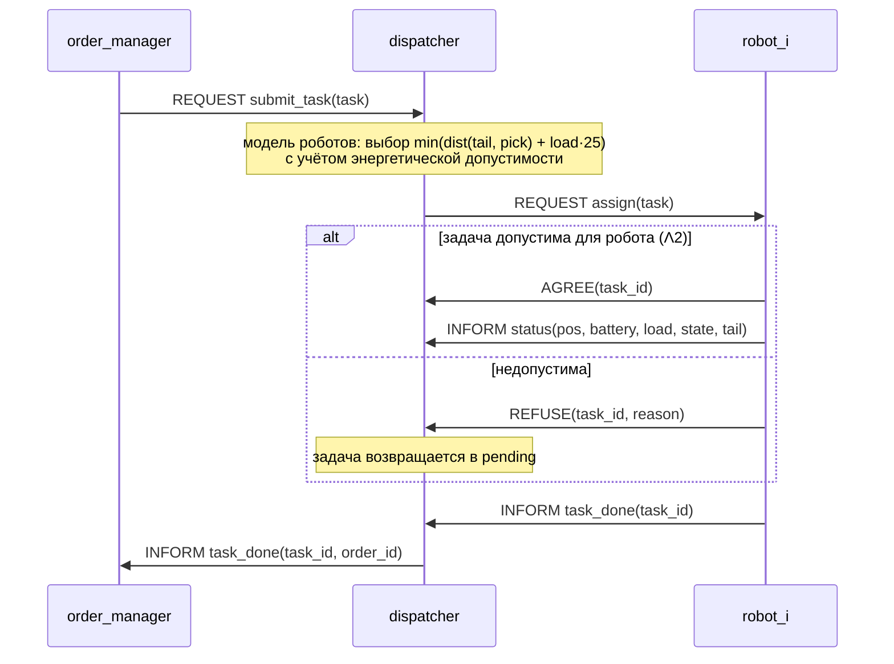
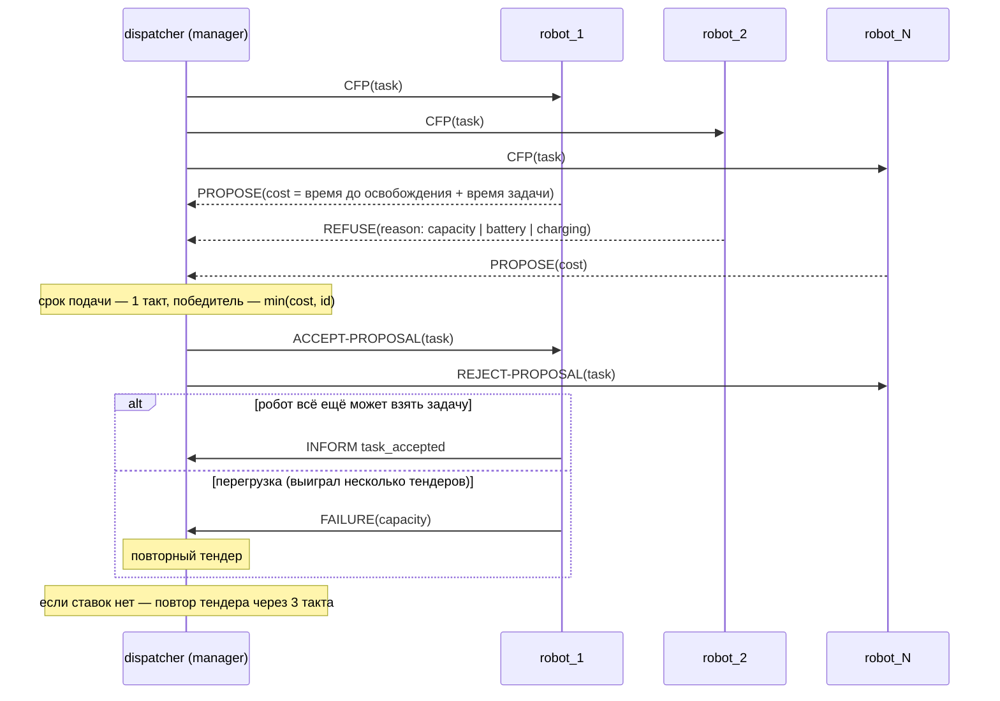
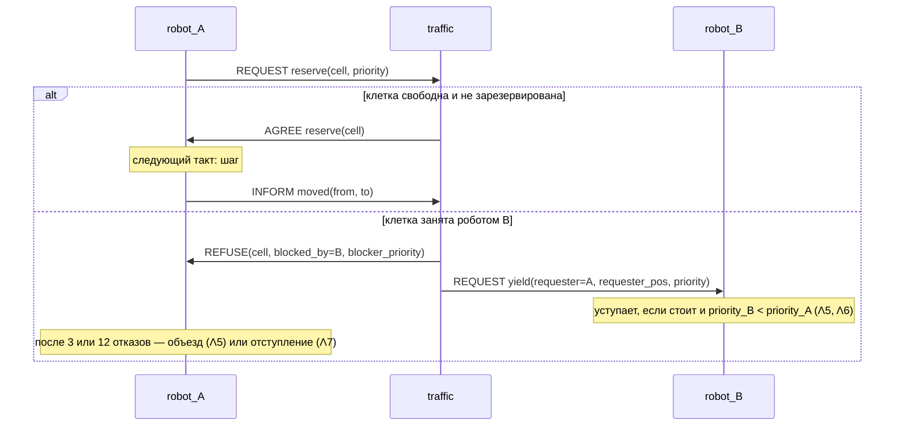
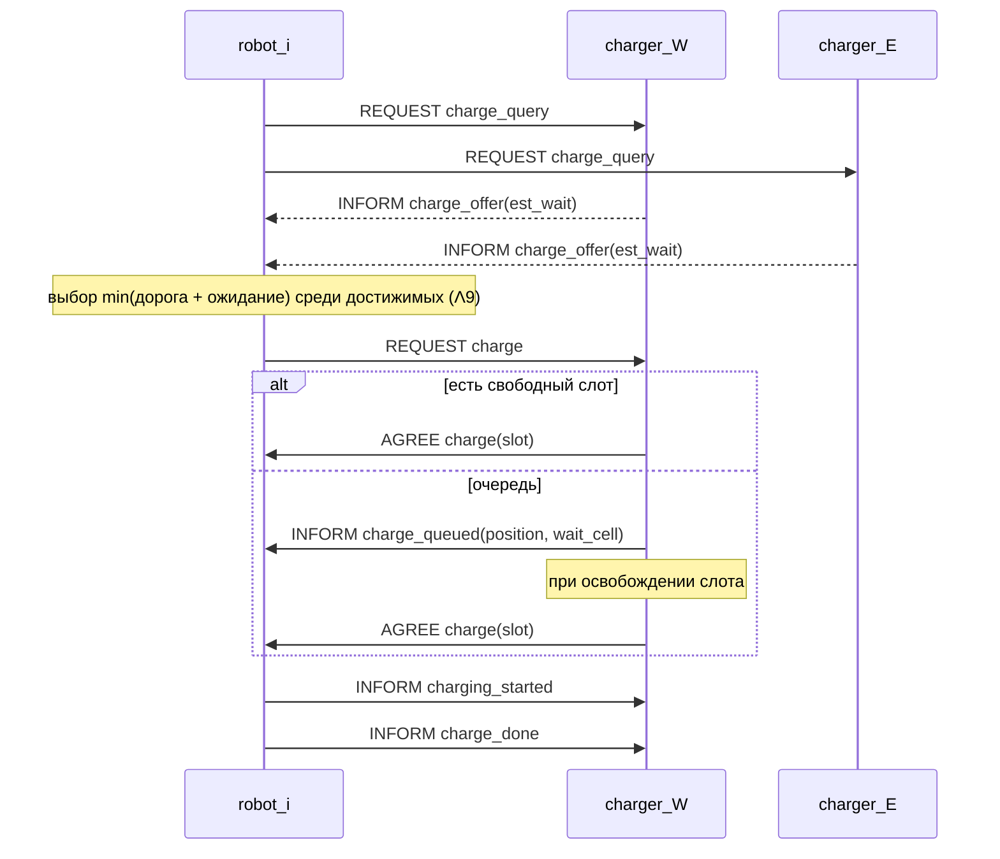
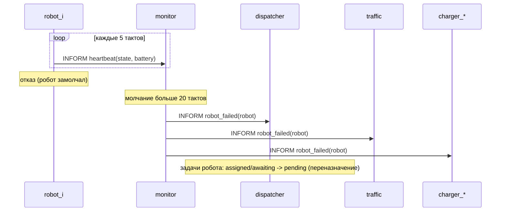
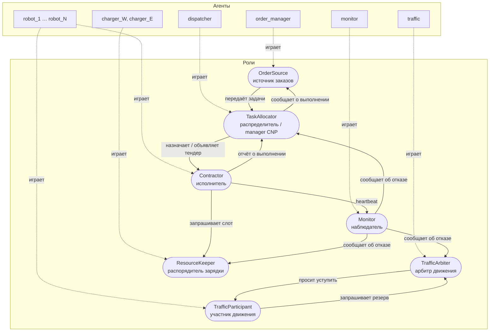
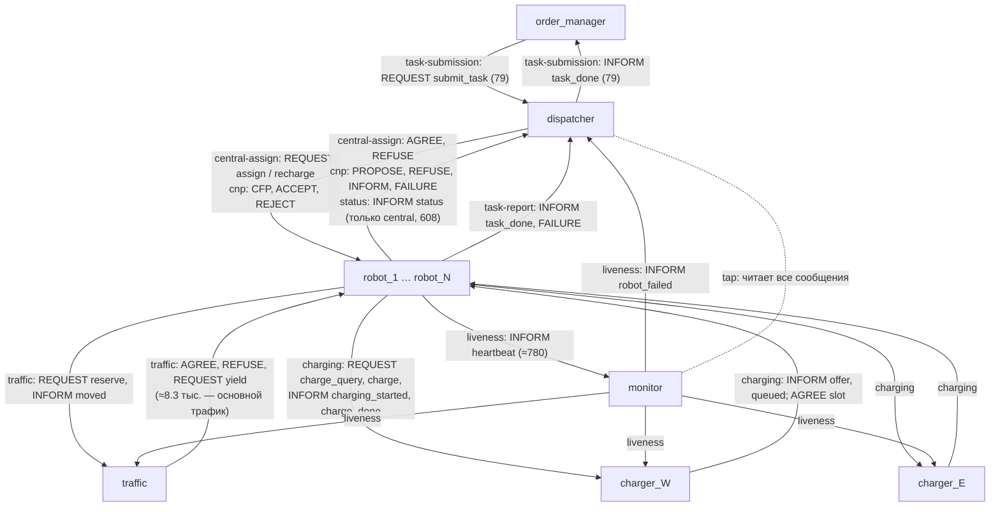
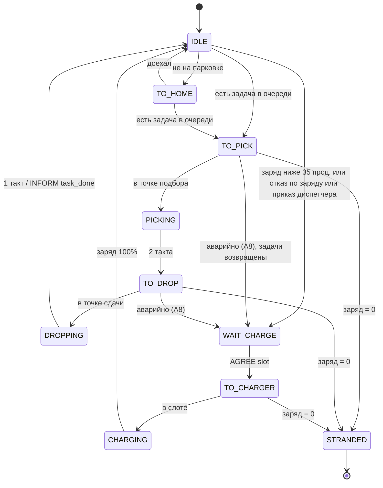

# Лабораторная работа №1
## «Спецификация и архитектурное проектирование многоагентной системы»

**Курс:** Теория многоагентных систем

**Студент:** Малышев Кирилл Борисович, группа Б24-527

**Тема МАС:** координация группы автономных мобильных роботов на складе (сборка заказов)

**Исходный код и демонстрация:** каталог `warehouse_mas/` + `run.py`, описание запуска — в `README.md` (приложение; репозиторий: [github.com/MalyshevKB/multi-agent-syst](https://github.com/MalyshevKB/multi-agent-syst), папка `ЛР1/`)

---

## 1. Выбор и описание прикладной задачи

### 1.1. Содержательная постановка

Склад интернет-магазина обслуживает группа автономных мобильных роботов (AMR). В систему непрерывно поступают **заказы**. Каждый заказ состоит из 1–3 позиций, лежащих на разных стеллажах. Каждая позиция — это отдельная **задача**: доехать до стеллажа, взять товар (2 такта), отвезти на закреплённую за заказом **станцию упаковки** и сдать (1 такт). Заказ выполнен, когда сданы все его позиции.

Роботы работают в общей среде с ограниченными ресурсами:

- **проходы** между стеллажами однополосные: в клетке одновременно может находиться только один робот;
- **энергия**: у робота батарея на 120 единиц, 1 шаг = 1 единица; зарядка восстанавливает 6 единиц за такт;
- **зарядные станции**: две (запад и восток), по умолчанию по одному слоту на каждой, то есть зарядок заметно меньше, чем роботов;
- **станции упаковки**: три, каждая обслуживается из одной клетки.

### 1.2. Цель системы и критерии эффективности

**Цель:** выполнить поток заказов как можно быстрее, не нарушая ограничений: нет столкновений, ни один робот не разряжается в пути, ни одна задача не теряется и не выполняется дважды.

Показатели качества заданы на трёх уровнях: глобальном, локальном (уровень агента) и структурном.

| Уровень | Показатель | Формализация / смысл |
|---|---|---|
| **Глобальный: целевой функционал** (минимизация времени) | время завершения всех заказов (makespan) | $J = \min T_{end}$, где $T_{end}$ — такт сдачи последней позиции; по смыслу $J=\min\sum_{t=0}^{T} c(s_t,\vec a_t)$ при $c = 1$, пока есть невыполненные заказы |
| **Глобальный: утилитарное благосостояние** | среднее время выполнения заказа (lead time) | $W_{util} = -\frac{1}{\lvert O\rvert}\sum_{o} (t^{done}_o - t^{in}_o)$: суммарная выгода всех заказов |
| **Глобальный: эгалитарное благосостояние** (критерий Роулза) | максимальное время заказа | $W_{egal} = -\max_o (t^{done}_o - t^{in}_o)$: качество по «самому несчастному» заказу |
| **Глобальный: справедливость между агентами** | распределение задач по роботам, индекс Джейна | $(\sum x_i)^2 / (n \sum x_i^2)$, $x_i$ — задач у робота $i$ |
| **Локальный: штрафы** (безопасность и автономность) | столкновения, разряд в пути, ожидание в «пробках», перепланирования | штраф за столкновение (инвариант 1, п. 2.1), за перерасход энергии (инвариант 3), потери времени на конфликты |
| **Локальный: вознаграждение** | выполненные роботом задачи, загрузка | $R_i$ = +1 за сданную позицию; загрузка = доля тактов, когда робот выполняет задачу |
| **Структурный: эффективность коммуникаций** | сообщений на распределение одной задачи, общий трафик | отношение достигнутого результата (выполненные задачи) к объёму трафика |
| **Структурный: масштабируемость** | зависимость показателей от числа роботов $n$ | исследуется в ЛР2 (серия E2) |
| **Надёжность** | разряженные роботы, переназначения, дубли выполнения | соблюдение глобальных ограничений (п. 2.1) |

Показатель «сходимость к консенсусу» не применяется: роботам не нужно приходить к единому значению.

### 1.3. Почему эта задача подходит для МАС и последующих работ

- **Естественная распределённость.** Роботы — автономные физические сущности со своим локальным состоянием: позиция, заряд, обязательства. Центральная модель их состояния всегда немного устаревшая.
- **Есть что распределять (ЛР2).** Назначение задач роботам можно реализовать разными механизмами: централизованная диспетчеризация, контрактная сеть, аукционы, распределённое делегирование.
- **Есть конфликты и дефицит (ЛР3).** Это клетки проходов, слоты зарядки, точки сдачи; нужны правила приоритета, арбитраж, очереди.
- **Есть поверхность атаки и отказов (ЛР4).** Отказ робота, ложные ставки, ложные статусы, «вечная» задача, повторная передача задачи, блокировка ресурса.

### 1.4. Модель среды

Склад — дискретная сетка 19×11, время дискретное (такты).

```
  C w w w w w w w w w w w w w w w w w C     ряд 0  — зона зарядки: C — слот, w — место ожидания
  . . . . . . . . . . . . . . . . . . .     ряд 1  — поперечный проход
  . # # . # # . # # . # # . # # . # # .     ряды 2–4 — стеллажи (#) и однополосные проходы
  . # # . # # . # # . # # . # # . # # .
  . # # . # # . # # . # # . # # . # # .
  . . . . . . . . . . . . . . . . . . .     ряд 5  — поперечный проход
  . # # . # # . # # . # # . # # . # # .     ряды 6–8 — стеллажи
  . # # . # # . # # . # # . # # . # # .
  . # # . # # . # # . # # . # # . # # .
  . . . . . . . . . . . . . . . . . . .     ряд 9  — поперечный проход, точки сдачи над P
  . . . P . . . . . P . . . . . P . . .     ряд 10 — станции упаковки (P) и парковка роботов
       ↓     ↑     ↓     ↑     ↓     ↑     ↓   направления вертикальных проходов x = 0,3,…,18
```

Свойства среды (классификация Рассела–Норвига):

| Признак | Значение | Обоснование |
|---|---|---|
| Наблюдаемость | **частично наблюдаемая** | робот знает только своё состояние и карту; занятость клеток знает регулировщик, состояние слотов — станции |
| Эпизодичность | **последовательная** | текущее решение (взять задачу, ехать на зарядку) влияет на будущее: заряд, положение, очередь |
| Динамика | **динамическая** | пока робот принимает решение, другие роботы двигаются и поступают новые заказы |
| Дискретность | **дискретная** | конечное множество клеток, состояний и действий; дискретное время (такты) |
| Детерминированность | **стохастическая** | заказы поступают случайно (процесс Бернулли, p = 0,12 за такт), позиции выбираются случайно; результат действия зависит от действий других роботов |
| Число агентов | **многоагентная** | см. классификацию МАС ниже |

Для воспроизводимости все случайные процессы заданы зерном (`--seed`).

Классификация МАС:

| Признак | Тип МАС | Обоснование |
|---|---|---|
| По способу взаимодействия | **смешанная** | общая цель — выполнить заказы (кооперация), но роботы конкурируют за проходы и слоты зарядки; в ЛР3–4 появляются агенты с собственными конфликтующими интересами |
| По принципу управления | **иерархическая / гибридная** | координаторы (диспетчер, регулировщик, станции) задают цели и выдают ресурсы, исполнители (роботы) выполняют и отчитываются; при этом роботы автономно решают, брать ли задачу и когда заряжаться |
| По архитектуре агентов | **гибридная** | реактивные агенты-арбитры и гибридные (реактивно-рассуждающие) роботы, п. 2.2 |

---

## 2. Формальное описание многоагентной системы

### 2.1. Общая формальная модель

МАС задаётся кортежем

$$\mathcal{MAS} = \langle \mathcal{A},\ \mathcal{E},\ \mathcal{R},\ \mathcal{O},\ \mathcal{C},\ \Pi,\ \mathcal{P},\ \Lambda \rangle,$$

где
- $\mathcal{A} = \{a_{om}, a_{d}, a_{tc}, a_{cW}, a_{cE}, a_{mon}\} \cup \{r_1,\dots,r_N\}$ — множество агентов;
- $\mathcal{E} = \langle G, T, \tau \rangle$ — среда: граф проходимости склада $G=(V,E)$ с ориентированными рёбрами в однополосных проходах; множество типов клеток $T=\{\text{free}, \text{shelf}, \text{station}, \text{charger}, \text{bay}\}$; дискретное время $\tau \in \mathbb{N}$;
- $\mathcal{R}$ — множество ролей (п. 2.3); отображение $\rho: \mathcal{A} \to 2^{\mathcal{R}}$ назначает агентам роли;
- $\mathcal{O}$ — онтология предметной области (понятия *Order, Task, Cell, Reservation, Slot, Bid, Status*);
- $\mathcal{C}$ — каналы связи (п. 2.6);
- $\Pi$ — протоколы взаимодействия (п. 3);
- $\mathcal{P}$ — полномочия: отношение «кто вправе инициировать какое действие над каким объектом» (п. 2.5);
- $\Lambda$ — правила взаимодействия и ограничения (п. 2.7).

**Задача** — кортеж $t = \langle id, order, s, p, d, \tau_c\rangle$, где $s$ — стеллаж, $p$ — точка подбора (клетка прохода рядом со стеллажом), $d$ — точка сдачи у станции, $\tau_c$ — время создания.

**Состояние робота** — $\sigma_i = \langle pos_i, b_i, q_i, st_i, goal_i, path_i \rangle$: позиция, заряд, очередь обязательств ($|q_i| \le 2$), состояние конечного автомата, текущая цель и маршрут.

**Глобальные ограничения** (инварианты):
1. $\forall \tau,\ \forall i \ne j:\ pos_i(\tau) \ne pos_j(\tau)$ — нет двух роботов в одной клетке.
2. $\forall t:\ |\{ r : t \in q_r \}| \le 1$ — задача закреплена не более чем за одним роботом.
3. $\forall i:\ b_i(\tau) > 0$ вне зарядки — робот не разряжается в пути (мягкое ограничение, нарушение = отказ).
4. Перемещение по ребру $(u,v)$ допустимо, только если $(u,v)\in E$ и робот получил резерв клетки $v$.

### 2.1.1. Формальная модель среды

В расширенной модели среда — это кортеж

$$E = \langle S,\ \vec A,\ P,\ \vec\Omega,\ O,\ \vec R,\ \gamma \rangle .$$

| Элемент | В нашей системе |
|---|---|
| $S$ — множество макросостояний среды | вектор: позиции и состояния всех роботов, заряды, очереди задач, занятость слотов зарядки, поток заказов. Структура склада задаётся графом проходимости $G=(V,E)$ с типами клеток $T$ (неизменная часть $S$) |
| $\vec A = A_1\times\dots\times A_n$ — пространство совместных действий | $A_i$ робота = {шаг в соседнюю клетку, ожидание, взять, сдать, заряжаться} ∪ коммуникативные действия (отправка сообщений); $\vec a_t$ — одновременный шаг всех агентов на такте $t$ |
| $P: S\times\vec A\times S\to[0,1]$ — функция перехода | перемещения, взятие, сдача, расход и пополнение заряда — **детерминированы** ($f_{env}: S\times\vec A\to S$); стохастичность вносит только поступление заказов (Бернулли, $p$) и выбор позиций заказа |
| $\vec\Omega = \Omega_1\times\dots\times\Omega_n$ — пространство восприятий | $\Omega_i$ робота: собственные позиция и заряд + входящие сообщения (разрешения клеток, предложения задач, ответы станций). Других роботов робот «видит» только через отказы регулировщика |
| $O$ — функция наблюдения | детерминированная функция видимости $v_i: S \to \Omega_i$, скрывающая состояние других агентов: среда **частично наблюдаема** (модель POMDP). В ЛР4 канал теряет сообщения, и $O$ становится стохастической |
| $\vec R = (R_1,\dots,R_n)$ — вознаграждения | $R_i(s,\vec a) = +1$ за сданную позицию; штрафы: столкновение (запрещено инвариантом 1), полный разряд, ожидание в пробке |
| $\gamma \in [0,1)$ — дисконтирование | горизонт конечен (поток из $N_{orders}$ заказов), поэтому $\gamma \to 1$; спешку задаёт целевой функционал $J$ (время завершения) |

**Локальное и глобальное состояние.**
- Локальное состояние робота $S_i$ — его внутренняя информация: $\sigma_i = \langle pos_i, b_i, q_i, st_i, goal_i, path_i \rangle$ (это $S_{in}$ когнитивной модели, п. 2.1.2).
- Состояние среды $S_{env}$ — карта склада, стеллажи, станции, поток заказов, физическое положение предметов.
- Глобальное состояние системы:
$$S_{global} = S_{env}\times S_{om}\times S_{d}\times S_{tc}\times S_{cW}\times S_{cE}\times S_{mon}\times S_{r_1}\times\dots\times S_{r_N}.$$
Его не видит ни один агент целиком; ближе всех к нему наблюдатель (через трассу) и симулятор.

**История.**
- Локальная история робота $h_i^t = (\omega_{i,0}, a_{i,0}, \omega_{i,1}, a_{i,1}, \dots, \omega_{i,t})$ хранится неявно: в убеждениях (очередь обязательств, кредиты, карта) и в счётчиках (заряд, ожидание).
- Глобальная история $h^t_{global} = (s_0, \vec a_0, s_1, \vec a_1, \dots, s_t)$ в части коммуникативных действий **записывается явно**: агент `monitor` ведёт трассу всех сообщений (JSONL). На этой трассе считаются показатели и строится диверсионный анализ ЛР4.

### 2.1.2. Формальные модели агентов (три уровня)

**Уровень 1 — классическая модель** $Ag: P^*\to A$. В этой форме агент — «чёрный ящик» и описывается только своими протоколами (п. 3). Так он виден другим агентам и проектировщику на уровне ролей.

**Уровень 2 — модель с внутренним состоянием** $Ag = \langle I, see, next, action\rangle$. Ею описываются реактивные агенты-арбитры:

| Агент | $I$ — внутреннее состояние | $see$ — восприятие | $next$ — обновление | $action$ — действие |
|---|---|---|---|---|
| `traffic` | позиции роботов, резервы клеток, приоритеты | входящие `reserve`, `moved` | записать позицию / резерв | AGREE или REFUSE + просьба уступить |
| `charger_*` | занятость слотов, очередь, места ожидания, копия реестра репутации | `charge_query`, `charge`, `charge_done` | поставить в очередь / освободить слот | выдать слот, сообщить позицию в очереди, предложить уступку (ЛР3) |
| `order_manager` | реестр заказов | `task_done` | отметить позицию | создать заказ и задачи |
| `monitor` | время последнего сигнала каждого робота, трасса | все сообщения (прослушка) | обновить время, записать трассу | объявить отказ |

**Уровень 3 — расширенная когнитивная модель** $Ag = \langle S_{in}, K, G, A, \pi, C\rangle$. Ею описывается робот (и, в упрощённом виде, диспетчер):

| Блок | Робот |
|---|---|
| $S_{in}$ — текущее состояние (динамическая память) | позиция, заряд, текущая задача и очередь обязательств ($\le 2$), состояние автомата (рис. 3), цель и маршрут, флаг «не хватает заряда»; $S_{in}^{t+1} = f(S_{in}^t, P_t)$ на каждом такте |
| $K$ — знания (статические) | карта склада и ориентированный граф проходимости, таблица кратчайших расстояний, координаты станций, нормативы (время подбора и сдачи, расход 1 ед./шаг, скорость зарядки), правила Λ |
| $G$ — цели | предикаты: «все принятые задачи сданы», «заряд > 0 всегда», «не блокировать проходы»; функция полезности при торгах — минимизация времени до выполнения обязательств |
| $A$ — действия | движение, ожидание, взять, сдать, заряжаться + коммуникативные акты (PROPOSE, AGREE, REFUSE, INFORM, …) |
| $\pi: S_{in}\times K\times G\to A$ — политика | конечный автомат с правилами выбора: следующая задача из очереди, уход на зарядку, путь BFS, ставка «время до освобождения + время задачи» |
| $C: S_{in}\times A\to\{0,1\}$ — ограничения (guardrails) | имеют абсолютный приоритет над $\pi$ и $G$: шаг только в зарезервированную клетку (Λ3); только по направлению прохода (Λ4); не брать задачу, если не хватит заряда (Λ2); аварийно уйти на зарядку при заряде ≤ расстояние + резерв (Λ8) |

Жизненный цикл робота на такте повторяет цикл когнитивной модели:
1. **Восприятие:** входящие сообщения и собственный заряд.
2. **Обновление:** $S_{in}$ — новая позиция, очередь, ответы станций.
3. **Оценка целей:** задача сдана — цель снята; заряд мал — появляется цель «зарядиться».
4. **Фильтрация по ограничениям:** из $A$ остаются допустимые действия $A_{allowed}$ (клетка зарезервирована, направление верное, заряда хватает).
5. **Принятие решения:** $\pi$ выбирает лучшее допустимое действие.
6. **Действие** и переход на следующий такт.

### 2.2. Агенты

| Агент | Кол-во | Архитектура | Класс по Тарасову | Назначение |
|---|---|---|---|---|
| `order_manager` — менеджер заказов | 1 | реактивная | реактивный | приём заказов, декомпозиция на задачи, учёт выполнения |
| `dispatcher` — диспетчер | 1 | рассуждающая (модель роботов + правило выбора) | активный: внутреннее состояние и цели | распределение задач (сменный механизм: `central` / `cnp`), переназначение |
| `robot_i` — робот | N (4–12) | **гибридная** слоистая: реактивный слой + целенаправленный BDI-слой (п. 2.3.1) | **проактивный**: модель среды (карта, расстояния), прогноз последствий (хватит ли заряда, когда освободится) | исполнение задач, движение, управление энергией |
| `traffic` — регулировщик движения | 1 | реактивная («стимул — реакция») | реактивный | резервирование клеток, разрешение конфликтов проезда |
| `charger_W`, `charger_E` — зарядные станции | 2 | реактивная | реактивный | распределение слотов зарядки и мест ожидания |
| `monitor` — наблюдатель | 1 | реактивная | реактивный | трассировка сообщений, контроль живости, оповещение об отказах |

По классификации Рассела–Норвига:
- роботы — **планирующие** (строят цепочки действий: путь BFS, порядок обязательств), **автономные**, **полностью автономные** по уровню автономности (сами принимают и отклоняют задачи, решают о зарядке), **асинхронные** по способу коммуникации (решения по сообщениям, без синхронных вызовов), **реактивные** по обучаемости (не обучаются);
- остальные агенты — **сервисные**: выполняют запросы других агентов.

Обучение в систему сознательно не включено: в ЛР2–ЛР4 нужно сравнивать механизмы при неизменном поведении агентов.

### 2.3. Роли, цели, знания, состояния, действия

Роль — это «профессия» агента, абстрактное описание функционального назначения. Она не зависит от кода. Спецификация каждой роли включает:
- **цель** — зачем роль существует;
- **компетенции** — какими знаниями и методами она должна обладать;
- **«персону»** — в каком формате и с какими ограничениями роль выдаёт результат. У нас это формат сообщений протокола, п. 2.6.

Для каждой роли ниже указаны также знания, состояния, действия и разрешения (в стиле методологии Gaia).

**Сводная спецификация ролей и группировка:**

| Роль | Группа ролей | Цель | Компетенции | «Персона»: формат результата | Место в графе: кто даёт задачи / кому отчитывается |
|---|---|---|---|---|---|
| OrderSource | управляющая (Manager) | превратить заказы в задачи, учесть выполнение | декомпозиция заказа | `REQUEST submit_task` со структурой Task | задачи получает извне (WMS); отчёты получает от диспетчера |
| TaskAllocator | управляющая / координирующая (Orchestrator) | каждая задача — ровно одному способному исполнителю | модель роботов, механизм распределения | `REQUEST assign`, `CFP`, `ACCEPT/REJECT` | задачи от OrderSource; отчитывается OrderSource |
| Contractor | исполнительная (Worker) | выполнить принятые задачи, не разрядиться | планирование пути, оценка стоимости и энергии | `AGREE/REFUSE`, `PROPOSE(cost)`, `INFORM task_done` | задачи от TaskAllocator; отчитывается ему же |
| TrafficParticipant | исполнительная (Worker) | безопасно двигаться | правила Λ3–Λ7 | `REQUEST reserve(cell, priority)`, `INFORM moved` | разрешения от TrafficArbiter |
| TrafficArbiter | координирующая (арбитр ресурса) | ни одного столкновения | карта занятости | `AGREE/REFUSE reserve`, `REQUEST yield` | запросы от участников движения |
| ResourceKeeper | координирующая (арбитр ресурса) | полное и справедливое использование слотов | очередь, политика выдачи | `INFORM charge_offer/queued`, `AGREE charge(slot)` | заявки от исполнителей |
| Monitor | **контролирующая (Supervisor / Validator)** | обнаруживать отказы, вести трассу | контроль живости, журналирование | `INFORM robot_failed` | наблюдает всех; сообщает координаторам |

**Роль и реализация.** Роли и программные агенты разведены:
- один программный класс `RobotAgent` играет **две** роли: Contractor и TrafficParticipant;
- один класс `ChargingStationAgent` развёрнут в двух экземплярах одной роли ResourceKeeper;
- механизм распределения в роли TaskAllocator заменяется в ЛР2 без изменения остальных ролей: меняется реализация, архитектура ролей остаётся прежней.

#### Роль «Источник заказов» (OrderSource) — агент `order_manager`
- **Цели:** превратить каждый заказ в набор задач; зафиксировать момент выполнения заказа.
- **Знания:** реестр заказов `{order → tasks, done, created, completed}`, карта (стеллажи, точки подбора, станции).
- **Состояния:** единственное рабочее состояние (реактивный агент).
- **Действия:** `generate_order`, `decompose(order) → tasks`, `submit(task)`, `register_done(task)`, `detect_duplicate(task)`.

#### Роль «Распределитель задач» (TaskAllocator / Manager в CNP) — агент `dispatcher`
- **Цели:** каждая задача назначена ровно одному способному исполнителю; минимизировать время выполнения и стоимость координации.
- **Знания:**
  - пул ожидающих задач `pending`;
  - таблицы `awaiting` (предложено, ждём подтверждения) и `assigned` (подтверждено);
  - множество отказавших роботов `dead`;
  - в режиме `central` — **модель роботов** `{pos, battery, load, state, tail, energy}` по их статусам;
  - в режиме `cnp` — открытые **тендеры** `{task → bids, deadline}`.
- **Состояния:** рабочий цикл «принять → распределить → подтвердить / переназначить».
- **Действия:** `select_robot` (central), `announce_cfp`, `evaluate_bids`, `award`, `requeue`, `order_recharge`, `forward_done`.

#### Роль «Исполнитель» (Contractor) — агенты `robot_i`
- **Цели:**
  - (Д1) выполнить принятые задачи;
  - (Д2) не разрядиться;
  - (Д3) не мешать другим (освобождать проходы, возвращаться на парковку).
- **Знания (убеждения):** собственное состояние $\sigma_i$; карта и матрица расстояний ориентированного графа; координаты зарядных станций; оценки ожидания от станций.
- **Желания → намерения:** очередь обязательств `queue`, текущая задача `task`, цель `goal`.
- **Состояния (конечный автомат):** см. рис. 3 — `IDLE, TO_PICK, PICKING, TO_DROP, DROPPING, TO_HOME, WAIT_CHARGE, TO_CHARGER, CHARGING, STRANDED`.
- **Действия:**
  - движение: `move(cell)`, `request_reservation(cell)`, `replan(avoid)`, `step_aside`;
  - работа: `pick`, `drop`;
  - энергия: `charge`, `query_stations`, `choose_station`;
  - коммуникация: `bid(task)`, `accept/refuse(task)`, `report_status`, `heartbeat`, `release_tasks`.

#### Роль «Участник движения» (TrafficParticipant) — агенты `robot_i`
Входит в роль «Исполнитель» как реактивный уровень: запрашивает резерв следующей клетки, ждёт, перепланирует маршрут, уступает дорогу по правилу приоритетов.

#### 2.3.1. BDI-модель робота

Делиберативный слой робота построен по архитектуре «Убеждения — Желания — Намерения»:

| Компонент BDI | У робота |
|---|---|
| **Убеждения (Beliefs)** — что агент знает о мире | собственные позиция и заряд; очередь обязательств; карта и таблица расстояний; ответы станций об ожидании; флаг «не хватает заряда». Убеждения бывают **неточными**: робот не знает положения других роботов и узнаёт о них только по отказам регулировщика |
| **Желания (Desires)** — чего агент хочет | «выполнить задачи», «не разрядиться», «не мешать другим», «вернуться на парковку». Желания **противоречат друг другу**: «активно работать» против «экономить батарею» — классический пример конфликта желаний |
| **Намерения (Intentions)** — что агент обязался сделать | текущая задача и очередь принятых задач (обязательство — *commitment*), выбранная цель движения (точка подбора, точка сдачи, слот, парковка) и построенный маршрут |

Конвейер BDI-агента в реализации:
1. **Функция пересмотра убеждений (BRF)** — обработчики сообщений и шаг такта обновляют позицию, заряд, очередь, ответы станций.
2. **Генерация опций (желаний)** — на такте возникают варианты: начать следующую задачу, ехать заряжаться, вернуться на парковку, ответить на предложение задачи.
3. **Фильтр (Deliberation)** — разрешает конфликт желаний: задача принимается, только если после неё хватит заряда до станции (`can_take`, Λ2); при нехватке заряда «зарядиться» вытесняет «работать».
4. **Планировщик** — поиск в ширину по ориентированному графу склада строит маршрут к цели.

Цикл работы:
1. восприятие;
2. обновление убеждений;
3. обдумывание (опции → намерения);
4. планирование;
5. исполнение одного шага;
6. **проверка**: если намерение стало недостижимым или потеряло смысл, план сбрасывается.

Примеры проверки:
- клетка занята → объезд (Λ5) или отступление (Λ7);
- заряд упал → аварийный уход на зарядку с возвратом задач (Λ8).

Робот не бросает намерение при первой помехе: он перестраивает маршрут, а не отказывается от задачи. Это «настойчивость при сбоях» BDI. От «слепого обязательства» его защищает проверка достижимости по заряду.

#### Роль «Арбитр движения» (TrafficArbiter) — агент `traffic`
- **Цели:** исключить столкновения (инвариант 1); снижать простои в пробках.
- **Знания:** позиции всех роботов, таблица резервов `{cell → (robot, tick)}`, последние заявленные приоритеты роботов.
- **Действия:** `grant(cell)`, `refuse(cell, blocked_by, blocker_priority)`, `ask_yield(occupant)`, `expire_reservations`.

#### Роль «Распорядитель ресурса» (ResourceKeeper) — агенты `charger_W`, `charger_E`
- **Цели:** справедливое (FIFO) и полное использование слотов зарядки.
- **Знания:** занятость слотов, очередь, занятость мест ожидания, оценка длительности зарядки.
- **Действия:** `offer(est_wait)`, `grant_slot`, `enqueue + assign_wait_cell`, `release_slot`.

#### Роль «Наблюдатель» (Monitor) — агент `monitor`
- **Цели:** обнаруживать отказы роботов; вести трассу всех сообщений для анализа (ЛР2–4).
- **Знания:** время последнего сообщения от каждого робота, журнал сообщений.
- **Действия:** `trace(msg)`, `check_liveness`, `declare_failed(robot)`.

### 2.4. Средства (ресурсы и инструменты) агентов

| Агент | Средства |
|---|---|
| робот | шасси (перемещение на 1 клетку за такт), манипулятор (pick/drop), батарея, планировщик путей (BFS по ориентированному графу), оценщик стоимости задачи |
| диспетчер | модель состояния роботов, функция оценки (расстояние + загрузка), таймеры тендеров |
| регулировщик | карта занятости и резервов |
| станции зарядки | слоты зарядки (1–2), места ожидания (4 на станцию) |
| менеджер заказов | генератор потока заказов (в реальной системе — интерфейс с WMS) |
| наблюдатель | доступ на чтение ко всей шине сообщений (tap) |

### 2.5. Полномочия

| Действие над объектом | Кто вправе | Кто не вправе |
|---|---|---|
| Создать задачу | `order_manager` | все остальные |
| Назначить / переназначить задачу | `dispatcher` | роботы не передают задачи друг другу напрямую |
| Отказаться от задачи (до принятия) | робот (REFUSE с причиной) | — |
| Вернуть принятую задачу | робот: только через FAILURE диспетчеру (зарядка, разряд) | — |
| Занять клетку | робот, только по AGREE от `traffic` | — |
| Выдать резерв клетки | `traffic` | — |
| Попросить уступить дорогу | `traffic` | роботы друг друга напрямую |
| Выдать слот зарядки | станция-владелец слота | диспетчер, роботы |
| Приказать идти на зарядку | `dispatcher` (только свободному роботу) | — |
| Объявить робота отказавшим | `monitor` | — |
| Засчитать выполнение заказа | `order_manager` (по сообщению диспетчера) | роботы напрямую |

Таблица выше задаёт первую из трёх осей **границ полномочий** — доступ к действиям и средствам. Все три оси:

| Ось | Как реализована |
|---|---|
| **А. Доступ к инструментам и средствам** (принцип наименьших привилегий) | матрица выше: например, слот выдаёт только его станция, разрешение на клетку — только регулировщик, назначение задачи — только диспетчер |
| **Б. Доступ к информации** (изоляция данных) | робот знает только своё состояние и не видит ни позиций других роботов, ни модели диспетчера, ни очередей станций (только оценку ожидания). Диспетчер не видит маршрутов роботов. Регулировщик не знает задач. Станции не знают задач и маршрутов. Полную картину видит только наблюдатель, и только на чтение |
| **В. Автономия в принятии решений** | робот **сам** решает: принять или отклонить задачу (REFUSE с причиной), уступить ли дорогу, когда ехать заряжаться, на какую станцию. **Эскалация** к координатору: невыполнимые задачи робот возвращает диспетчеру (`FAILURE`), а не перепоручает сам; отказ робота наблюдатель эскалирует диспетчеру. Человек-оператор (human-in-the-loop) в контур не включён |

**Разделение ответственности**:
- **Принцип единственной обязанности.** Каждый агент отвечает за одну функцию: распределение, движение, зарядка, учёт заказов, контроль. Например, решение о проезде принимает регулировщик, а не диспетчер.
- **Изоляция сбоев.** Отказ робота не ломает систему: его задачи переназначаются (Λ10). Недостаток — в ЛР1 арбитры (регулировщик, станции) остаются единственными точками отказа; это исследуется в ЛР4.
- **Чёткие интерфейсы контрактов.** Агенты общаются только структурированными сообщениями с фиксированным форматом (п. 2.6). Исполнителю не важно, каким механизмом диспетчер выбрал его, — важна только структура задачи.

### 2.6. Каналы связи

- **Транспорт:** общая шина сообщений (`MessageBus`), адресация точка-точка (`robot_3`) и групповая (`group:robots`). Сообщения, отправленные на такте, доставляются раундами в том же такте, то есть задержка меньше такта. Сообщения отказавшему агенту теряются и учитываются как `lost`.
- **Формат сообщения** (подмножество FIPA-ACL):

| Поле | Назначение |
|---|---|
| `sender`, `receiver` | отправитель, получатель (агент или группа) |
| `performative` | коммуникативный акт: `request, agree, refuse, inform, failure, cfp, propose, accept-proposal, reject-proposal` |
| `protocol` | имя протокола: `task-submission, central-assign, cnp, status, task-report, traffic, charging, liveness` |
| `conversation_id` | идентификатор диалога (как правило, id задачи) |
| `content` | содержимое в терминах онтологии (`action`/`event` + параметры) |
| `tick`, `msg_id` | время и уникальный номер (для трассы) |

- **Стоимость:** каждая доставленная копия считается отдельно (CFP группе из 6 роботов = 6 сообщений).
- **Наблюдаемость:** `monitor` подключён к шине как «прослушка» (tap) и видит все сообщения.

### 2.7. Правила взаимодействия (Λ)

| № | Правило |
|---|---|
| Λ1 | **Единственность исполнителя.** Задача переходит `pending → awaiting → assigned → done`. Переход в `assigned` — только по подтверждению робота. Вернуть задачу в `pending` может только диспетчер (по REFUSE / FAILURE / отказу робота). |
| Λ2 | **Энергетическая допустимость.** Робот принимает задачу, только если `заряд − энергия текущих обязательств − энергия новой задачи ≥ расстояние(точка сдачи, ближайшая зарядка) + резерв (20)`. |
| Λ3 | **Резервирование.** Шаг в клетку — только при действующем резерве. Резерв живёт 1 такт и снимается после перемещения. |
| Λ4 | **Односторонние проходы.** Вертикальные проходы между стеллажами односторонние, направления чередуются. Против направления можно двигаться только в аварийном режиме, после долгой блокировки. |
| Λ5 | **Приоритет проезда.** `TO_CHARGER (4) > TO_DROP (3) > TO_PICK (2) > WAIT_CHARGE (1) > IDLE/TO_HOME (0)`. При конфликте объезд ищет робот с меньшим приоритетом (при равенстве — с бо́льшим id) после 3 отказов; второй — только после 12. |
| Λ6 | **Уступка.** По просьбе `traffic` шаг в сторону делает только **стоящий** свободный робот (`IDLE`, `TO_HOME`, `WAIT_CHARGE` без маршрута), и только при достаточном заряде. |
| Λ7 | **Отступление.** Если цель занята роботом, которому по Λ5 надо уступить, робот через 6 отказов отступает на соседнюю клетку. |
| Λ8 | **Зарядка.** Свободный робот идёт заряжаться при заряде < 35 % или после отказа от задачи из-за заряда. В пути он уходит на зарядку аварийно, если `заряд ≤ расстояние до зарядки + 15`, и возвращает задачи диспетчеру. |
| Λ9 | **Выбор станции.** Робот опрашивает все станции и выбирает минимум «дорога + ожидание» среди станций, до которых хватит заряда. Станция обслуживает очередь FIFO и выдаёт **уникальные** места ожидания. |
| Λ10 | **Живость.** Робот шлёт heartbeat каждые 5 тактов. Молчание больше 20 тактов означает отказ: диспетчер переназначает задачи робота, регулировщик считает его клетку препятствием. |
| Λ11 | **Идемпотентность.** Повторное сообщение о выполнении задачи не засчитывается дважды (`order_manager`) и снимает её из очереди (`dispatcher`). |
| Λ12 | **Приказ на зарядку.** Если исполнителя для задачи нет, а у свободных роботов не хватает заряда, диспетчер отправляет на зарядку наименее заряженного из них. |

---

## 3. Протоколы взаимодействия

### 3.1. Приём задачи и централизованное назначение (`task-submission`, `central-assign`, `status`)



### 3.2. Контрактная сеть (`cnp`)



### 3.3. Движение: резервирование клеток и уступка дороги (`traffic`)



### 3.4. Зарядка (`charging`)



### 3.5. Контроль живости и обработка отказа (`liveness`, `task-report`)



Добровольный возврат задач: при уходе на зарядку робот отправляет `FAILURE(task_ids, reason=charging)`, при полном разряде — `FAILURE(task_ids, reason=battery_depleted)`.

---

## 4. Диаграмма ролей и граф коммуникаций

### 4.1. Диаграмма ролей (рис. 1)



Связи между ролями:
- **иерархические:** TaskAllocator → Contractor (назначение);
- **рыночные:** TaskAllocator ↔ Contractor в режиме CNP;
- **арбитражные:** TrafficParticipant ↔ TrafficArbiter, Contractor ↔ ResourceKeeper;
- **контрольные:** Monitor → все.

Один агент-робот совмещает две роли. Делиберативный уровень отвечает за роль исполнителя, реактивный — за роль участника движения.

**Организационная модель в терминах AGR (Agent / Group / Role).** Взаимодействие разбито на группы. Общаться напрямую могут только агенты одной группы; агент, состоящий в нескольких группах, служит связующим звеном.

| Группа | Роли в группе | Агенты |
|---|---|---|
| «Заказы» | OrderSource, TaskAllocator | `order_manager`, `dispatcher` |
| «Распределение задач» | TaskAllocator, Contractor | `dispatcher`, все роботы |
| «Движение» | TrafficArbiter, TrafficParticipant | `traffic`, все роботы |
| «Энергия» | ResourceKeeper, Contractor | `charger_*`, все роботы |
| «Контроль» | Monitor и все контролируемые роли | `monitor` и все агенты |

Роботы входят в группы «Распределение», «Движение», «Энергия» и связывают их. Диспетчер связывает «Заказы» и «Распределение». Это совпадает с графом коммуникаций ниже: рёбра есть только внутри групп.

### 4.2. Граф коммуникаций (рис. 2)

Подписи рёбер — протокол и перформативы. В скобках — число сообщений в эталонном прогоне (6 роботов, 40 заказов, seed 1, режим `central` / `cnp`).



**Формальное описание.** Топология общения — направленный граф

$$G_{comm} = \langle V, Re\rangle,\quad V = \{om, d, tc, cW, cE, mon, r_1,\dots,r_N\},$$

$$Re = \{(om,d),(d,om)\} \cup \{(d,r_i),(r_i,d),(r_i,tc),(tc,r_i),(r_i,cW),(cW,r_i),(r_i,cE),(cE,r_i),(r_i,mon)\}_{i=1}^N$$
$$\cup\ \{(mon,d),(mon,tc),(mon,cW),(mon,cE),(cW,rep),(rep,cW),(cE,rep),(rep,cE)\},$$

где $rep$ — реестр репутации, добавленный в ЛР3 (вместе с ним в $V$ входит вершина $rep$). Ребро $(i,j)\in Re$ означает, что агент $i$ может отправить сообщение агенту $j$.

Свойства графа:

| Свойство | В нашей системе |
|---|---|
| **Связность** | граф сильно связен через посредников: от любого робота к любому другому есть путь (например, $r_i \to d \to r_j$), но прямых рёбер $r_i \to r_j$ нет. В ЛР2 они появляются в режиме делегирования (кольцо $r_i \to r_{i+1}$). Консенсус между роботами не требуется, поэтому звёздная топология достаточна |
| **Динамичность** | $G_{comm}$ **статичен**: шина доставляет сообщения независимо от положения роботов; рёбра пропадают только при отказе агента (сообщения к нему теряются) |
| **Ограничения каналов** | в ЛР1–ЛР3 канал идеальный: задержка меньше такта, вероятность потери $p_{loss}=0$. Вес ребра — нагрузка в сообщениях (подписи на рис. 2). В ЛР4 исследуется $p_{loss}=0{,}03$ |

Наблюдения по структуре графа:
- роботы **не общаются друг с другом напрямую**, все взаимодействия идут через агентов-посредников (dispatcher, traffic, chargers). Это упрощает контроль полномочий (п. 2.5), но создаёт узлы с высокой нагрузкой;
- самая нагруженная дуга — `robots ↔ traffic` (≈80 % трафика). Регулировщик — потенциальное узкое место и единая точка отказа (кандидат на исследование в ЛР4);
- в режиме `cnp` дуга `dispatcher → robots` становится широковещательной: стоимость тендера растёт как O(N) на задачу.

### 4.3. Конечный автомат робота (рис. 3)



---

## 5. Обоснование выбора архитектуры

### 5.1. Рассмотренные альтернативы

| Критерий | Централизованный планировщик (1 агент) | Полностью децентрализованная (P2P) | Роевая (стигмергия) | На основе LLM-агентов | **Выбранная: гибридная иерархическая** |
|---|---|---|---|---|---|
| Явные правила и протоколы (требование курса) | + (но это не МАС) | + | ± (правила неявные, эмерджентные) | − (логика в весах модели) | **+** |
| Можно сравнивать механизмы распределения (ЛР2) | − | ± | − | ± | **+ (сменный модуль `central`/`cnp`)** |
| Есть конфликты ресурсов и арбитраж (ЛР3) | − (конфликты решаются в плане) | + | ± | ± | **+ (клетки, слоты, точки сдачи)** |
| Есть поверхность отказов и атак (ЛР4) | − (одна точка) | + | ± | + | **+ (ложные ставки, статусы, отказ узлов)** |
| Воспроизводимость и измеримость | + | + | + | − (недетерминизм, стоимость) | **+ (seed, трасса)** |
| Масштабирование по числу роботов | − | + | + | − | ± (узкие места явно видны) |
| Сложность реализации | низкая | высокая | средняя | средняя | средняя |

### 5.2. Аргументы в пользу выбранной архитектуры

1. **Иерархия + рынок.** Разделение «распределитель ↔ исполнители» позволяет заменить механизм распределения, не трогая остальное. В ЛР2 так можно сравнить централизованную диспетчеризацию, контрактную сеть, а позже аукционы и распределённое делегирование.
2. **Агенты-арбитры для ресурсов.** Регулировщик и станции зарядки локализуют конфликты: каждый ресурс имеет «владельца», правила доступа к нему явные (Λ3–Λ9). Это даёт естественную площадку для ЛР3: переговоры о слоте, вытеснение, репутация, санкции за удержание ресурса.
3. **Гибридные роботы.** Реактивный уровень (резерв клетки, ожидание, уступка) обеспечивает безопасность в реальном времени. Делиберативный уровень (оценка задачи, ставка, решение о зарядке) отвечает за рациональность. Это классическая слоистая архитектура (InteRRaP-подобная). Робот сам оценивает свою способность выполнить задачу, поэтому диспетчеру не нужно знать его точное состояние: это и есть автономия.
4. **Отдельный наблюдатель.** Трасса всех сообщений и контроль живости вынесены в отдельного агента. Это нужно для измерений (ЛР2–3) и для обнаружения отказов и аномалий (ЛР4).
5. **Отказ от LLM-агентов в ядре.** На один прогон приходятся десятки тысяч сообщений, а результаты должны быть воспроизводимы, поэтому языковые модели в контуре управления непрактичны. Их можно добавить позже как отдельную роль, например «оператора», формулирующего приоритеты заказов на естественном языке. Тогда появится сценарий «внедрения вредоносных инструкций» для ЛР4.

### 5.3. Проектные решения, принятые по итогам прототипирования

Прототип проверялся на 10 seed при 4–10 роботах. Первоначальная спецификация давала тупики, и это потребовало правок архитектуры:

| Выявленная проблема | Причина | Принятое решение |
|---|---|---|
| Взаимная блокировка у станций упаковки | станция была тупиковой клеткой: выезд только через клетку, где ждёт следующий | станция непроезжаема, сдача выполняется из клетки прохода (как подбор у стеллажа) |
| Встречные пробки в однополосных проходах (цепочки из 3+ роботов) | двустороннее движение в ширину одной клетки | **односторонние проходы** с чередованием направлений (Λ4) |
| «Маятник»: робот уступает и сразу возвращается, тратя заряд до нуля | уступать могли и едущие роботы | уступает только стоящий робот (Λ6); приоритеты проезда (Λ5) |
| Тупик в зоне зарядки | ожидающие стояли на подъезде к слоту, места ожидания выдавались по `позиция mod n` | отдельная зона ожидания без проезда, уникальные места ожидания, сообщение `charging_started` |
| Все роботы ехали к одной станции, другая простаивала | выбор ближайшей станции | протокол опроса станций (`charge_query → offer`) и выбор по «дорога + ожидание» (Λ9) |
| Робот выбирал дальнюю станцию и разряжался в пути | оценка не учитывала заряд | выбор только среди достижимых станций (Λ9) |
| Застой: свободные роботы не заряжаются и не берут задачи | заряд между порогом зарядки (35 %) и порогом допустимости задачи | флаг «отказ по заряду» → зарядка; приказ диспетчера на зарядку (Λ12) |

---

## 6. Прототип и демонстрация

### 6.1. Реализация

Python 3.10+, без внешних зависимостей. Все протоколы и правила запрограммированы явно, без готовых МАС-фреймворков.

| Модуль | Содержание |
|---|---|
| `messages.py` | перформативы, сообщение, шина доставки и подсчёт стоимости |
| `environment.py` | карта, ориентированный граф проходимости, BFS-маршруты, матрица расстояний |
| `agents/*.py` | шесть типов агентов (п. 2.2) |
| `simulation.py` | сборка МАС, тактовый цикл, внедрение отказов, метрики |
| `run.py` | CLI: режимы `central` / `cnp` / `both`, визуализация, трасса, отказы |

Режимы демонстрации:

```bash
python run.py --mode both                 # сравнение двух механизмов распределения
python run.py --mode cnp --render 20      # пошаговая карта склада каждые 20 тактов
python run.py --fail robot_2:150          # внедрение отказа робота
python run.py --trace trace.jsonl         # трасса всех сообщений (JSONL) для анализа
```

### 6.2. Проверка работоспособности спецификации

Эталонный прогон: 6 роботов, 40 заказов (79 задач), по одному слоту на зарядной станции, seed 1.

| Показатель | central | cnp |
|---|---|---|
| Выполнено заказов | 40 / 40 | 40 / 40 |
| Среднее / макс. время выполнения заказа, тактов | 197 / 384 | 212 / 429 |
| Время завершения всех заказов (makespan) | 648 | 683 |
| Сообщений на распределение одной задачи | 9,9 | 216,5 |
| Всего сообщений | 10 311 | 26 806 |
| Тактов ожидания в пробках | 414 | 344 |
| Загрузка роботов | 0,71 | 0,66 |
| Ожидание зарядки, тактов | 203 | 315 |
| Задач на робота (мин–макс) | 11–15 | 12–15 |
| Разряженные роботы / дубли выполнения | 0 / 0 | 0 / 0 |

Устойчивость по 10 seed (доля прогонов, где выполнены все 40 заказов):

| Роботов | central | cnp |
|---|---|---|
| 4 | 10/10 | 10/10 |
| 6 | 10/10 | 10/10 |
| 8 | 9/10 | 10/10 |
| 10 | 9/10 | 10/10 |

Это **проверка корректности спецификации**, а не исследование ЛР2. Тем не менее уже видны направления для следующих работ:
- контрактная сеть дороже по сообщениям более чем в 20 раз, в основном из-за повторных широковещательных тендеров, когда все роботы заняты;
- при высокой плотности роботов централизованный режим чаще допускает разрядки: модель диспетчера устаревает;
- выявлены два класса **критических отказов**:
  1. робот, отказавший на зарядном слоте, навсегда блокирует слот. При отказе двух таких роботов система останавливается (`--mode cnp --fail robot_2:150 --fail robot_5:300`);
  2. робот, отказавший в точке сдачи, делает невыполнимыми все заказы этой станции (`--mode central --fail robot_3:200`).

---

## 7. Связь с последующими лабораторными работами

Таблица составлена при проектировании и уточнена после выполнения ЛР2–ЛР4: в столбце «Что исследовано» указано то, что реально вошло в эти работы.

| ЛР | Что исследовано на этой МАС | Точки расширения в архитектуре |
|---|---|---|
| **ЛР2** — распределение задач и координация | пять механизмов: `central` (жадный), `hungarian` (оптимальное назначение Венгерским алгоритмом), `cnp`, пакетный закрытый аукцион первой цены (`auction`), распределённое делегирование по кольцу роботов (`delegation`); метрики: makespan, lead time, msgs/task, CPU, пробег без груза, индекс Джейна; зависимость от N, интенсивности потока и параметров механизмов (серии E1–E4, 680 прогонов). Аукцион Викри рассмотрен и обоснованно не выбран (ЛР2, п. 2.4) | `DispatcherAgent.step` (сменный механизм), функции `bid` / `can_take` робота, счётчики `MessageBus` |
| **ЛР3** — переговоры и конфликты | дефицит слотов зарядки; политики очереди FIFO («до»), приоритезация по срочности, переговоры о досрочном освобождении слота, проверка заявок по счётчику энергии с репутацией и эскалирующими санкциями против агентов, занижающих заряд; сравнение «до / после» по эффективности, справедливости (разброс ожидания, индекс Джейна) и соблюдению общесистемных ограничений (серии E1–E4, 420 прогонов). Конфликты за проходы по-прежнему решает регулировщик по правилам Λ3–Λ7 | `ChargingStationAgent` (политика очереди), агент репутации, правила Λ8–Λ9 |
| **ЛР4** — диверсионный анализ | 10 сценариев S1–S10: ложный отчёт о выполнении, саботажник с заниженными ставками, недоступность станции, подделка полномочий, циклическая передача задачи, два лидера-диспетчера, внедрение вредоносных заказов, потеря сообщений, отказ робота в точке сдачи, отказ регулировщика; детекторы аномалий по трассе (A1–A11) и 10 защитных ограничений; повторная оценка (340 прогонов) | `--fail`, трасса `monitor`, правила Λ10–Λ11; аутентификация и матрица полномочий, валидация, проверка выполнения, сторожевой таймер, тайм-ауты, эпохи лидерства, эвакуация, резервный регулировщик |

---

## 8. Выводы

1. Выбрана и формализована прикладная задача: координация группы складских роботов при потоке заказов, с ограниченными ресурсами (однополосные проходы, зарядные слоты, точки сдачи) и явными критериями эффективности.
2. Классифицированы среда и МАС:
   - среда — частично наблюдаемая, последовательная, динамическая, дискретная, стохастическая;
   - МАС — смешанная, иерархическая/гибридная, с гибридной архитектурой агентов.
3. Построена формальная модель:
   - среда $E=\langle S,\vec A,P,\vec\Omega,O,\vec R,\gamma\rangle$ (POMDP), локальные и глобальное состояния, история (трасса наблюдателя);
   - агенты-арбитры — моделью $\langle I, see, next, action\rangle$, робот — когнитивной моделью $\langle S_{in},K,G,A,\pi,C\rangle$ с ограничениями-guardrails;
   - показатели качества — на глобальном (целевой функционал, утилитарное и эгалитарное благосостояние), локальном (штрафы) и структурном (эффективность коммуникаций, масштабируемость) уровнях.
4. Спецификация МАС: 6 типов агентов и 7 ролей с целями, компетенциями, «персоной», знаниями, состояниями, действиями и средствами. Роли сгруппированы на исполнительные, управляющие и контролирующую. Также описаны:
   - BDI-модель робота с конвейером «пересмотр убеждений → опции → фильтр → планировщик»;
   - границы полномочий по трём осям (средства, информация, автономия и эскалация) и разделение ответственности;
   - каналы связи с форматом сообщений (подмножество FIPA-ACL), 12 правил взаимодействия и 5 протоколов;
   - организационная модель в терминах AGR.
5. Построены диаграмма ролей, граф коммуникаций $G_{comm}=\langle V,Re\rangle$ с количественной разметкой и анализом свойств (связность, статичность, ограничения каналов), конечный автомат робота и диаграммы последовательностей протоколов.
6. Обоснована гибридная иерархическая архитектура: распределитель со сменным механизмом, агенты-арбитры ресурсов, гибридные (реактивно-делиберативные) роботы и наблюдатель. Она лучше альтернатив подходит для экспериментов ЛР2–ЛР4.
7. Работоспособность спецификации подтверждена исполняемым прототипом. Прототипирование выявило 7 проблем исходного проекта (тупики, «маятник», застой по заряду), каждая устранена правкой правил взаимодействия. Обнаружены критические сценарии отказов, которые станут предметом ЛР4.

---

**Приложения** (предоставляются отдельно, не входят в отчёт): исходный код `warehouse_mas/`, `run.py`, инструкция `README.md`.
