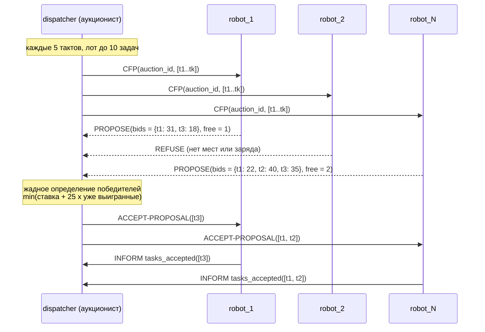
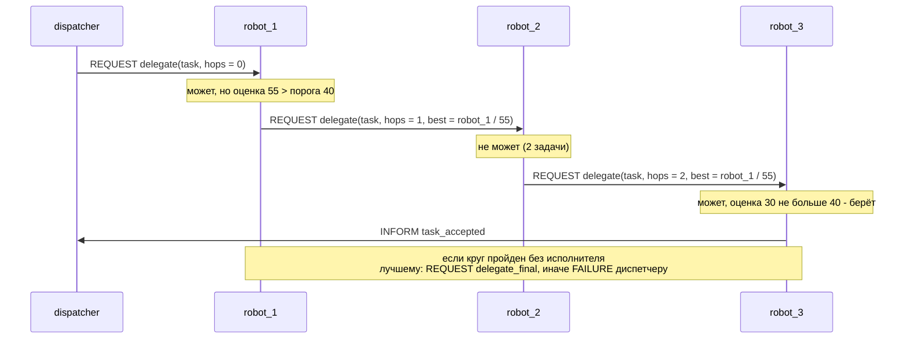
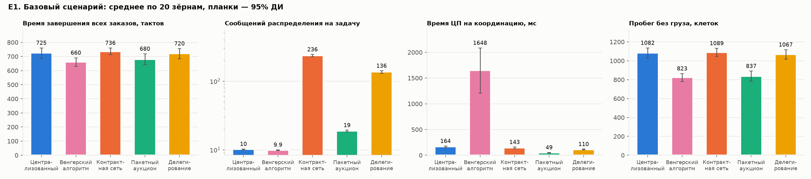
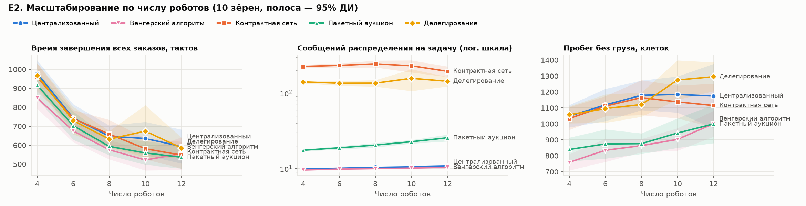
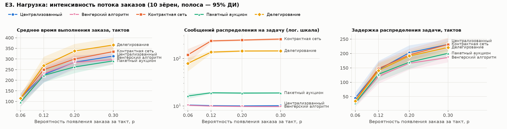
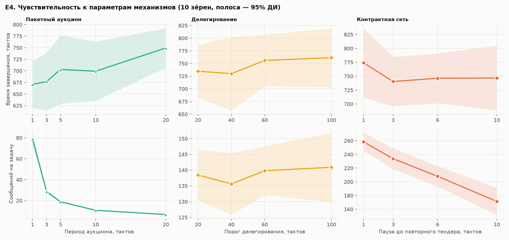

# Лабораторная работа №2
## «Исследование механизмов распределения задач и координации»

**Курс:** Теория многоагентных систем

**Студент:** Малышев Кирилл Борисович, группа Б24-527

**Система:** МАС координации складских роботов из ЛР1 (спецификация — отчёт по ЛР1)

**Исходный код, данные и графики:** `warehouse_mas/`, `run.py`, `experiments.py`, `analyze.py`, `results/`, `figures/` (приложения; репозиторий: [github.com/MalyshevKB/multi-agent-syst](https://github.com/MalyshevKB/multi-agent-syst), папка `ЛР2/`)

---

## 1. Цель и постановка

**Цель:** реализовать несколько механизмов распределения задач в одной и той же МАС и экспериментально сравнить их по показателям: время выполнения, число сообщений, вычислительная стоимость координации, качество распределения, баланс нагрузки, устойчивость.

### 1.1. Как делится работа

Распределение работы в МАС делится на три шага: декомпозиция цели, распределение ролей, назначение исполнителей. В нашей системе они выглядят так:

1. **Декомпозиция.** Глобальная цель «выполнить поток заказов» раскладывается в дерево: заказ — **И-узел** (заказ выполнен, когда сданы *все* его позиции), позиция — листовая задача «привезти товар со стеллажа на станцию упаковки». Это **продуктовая (пространственная) декомпозиция**: задачи делятся по объектам среды, то есть по стеллажам. Внутри задачи действует **временная декомпозиция** с частичным порядком «доехать ≺ взять ≺ отвезти ≺ сдать». Декомпозицию выполняет менеджер заказов (1–3 задачи на заказ).
2. **Распределение ролей.** Роботы однородны: у всех одна роль «Исполнитель» (ЛР1) и одинаковые компетенции. Поэтому реестр компетенций (Directory Facilitator) не нужен. Различаются роботы только текущими **ресурсными ограничениями** — зарядом и загрузкой (≤ 2 задачи: текущая + одна в очереди). Робот сам проверяет, хватит ли ему заряда (правило Λ2 из ЛР1).
3. **Назначение исполнителей** — предмет этой работы. Сравниваются пять механизмов, от централизованного «сверху вниз» до децентрализованного «снизу вверх».

Чтобы сравнение было честным, в разных прогонах меняется **только механизм назначения**:
- среда, правила движения, зарядки и мониторинга одинаковы;
- поток заказов при одном и том же зерне одинаков для всех механизмов: у генератора заказов свой ГСЧ.

## 2. Исследуемые механизмы

Реализовано пять механизмов, переключаются параметром `--mode`. Все протоколы и алгоритмы запрограммированы явно (`agents/dispatcher.py`, `agents/robot.py`, `hungarian.py`), без библиотечных решателей.

### 2.1. Централизованная диспетчеризация, жадная (`central`)

- Диспетчер держит **модель состояния роботов**: позиция, заряд, загрузка, состояние, точка, где робот освободится, энергия обязательств.
- Роботы сообщают о каждом изменении состояния (`INFORM status`).
- На каждом такте диспетчер проходит очередь задач по порядку (FIFO). Каждой задаче он назначает робота с минимальной оценкой «расстояние до точки подбора + загрузка × 25». Учитываются только роботы, которым по модели хватает заряда.
- Робот подтверждает назначение (`AGREE`) или отказывается (`REFUSE`), если модель устарела.

Это **жадное** решение задачи о назначениях: каждая задача получает лучшего робота «на сейчас» без учёта остальных задач.

**Решает:** диспетчер. **Нужна информация:** полная (модель). **Сообщений на задачу (теоретически):** 2 на назначение + поток статусов (~4–8 на задачу).

### 2.2. Централизованное оптимальное назначение — Венгерский алгоритм (`hungarian`)

Это классический централизованный подход к задаче о назначениях (Assignment Problem). Он служит **эталоном глобального оптимума**, с которым сравниваются остальные механизмы. Модель роботов и протокол назначения — как у `central`; различается только способ решения.

На каждом такте, когда есть готовые задачи, диспетчер строит **матрицу стоимостей** C:
- строки — готовые задачи (не больше 30 — ограничение размера при сложности O(n³));
- столбцы — свободные места в очередях роботов: у робота с загрузкой `load` свободно `2 − load` мест;
- $c_{ij}$ = расстояние от точки освобождения робота до точки подбора + (номер места) × 25 тактов. Второе место того же робота дороже: задачу он выполнит позже;
- энергетически недопустимая пара получает запретную стоимость $10^6$;
- матрица дополняется фиктивными столбцами стоимости $10^5$: задача, не получившая реального исполнителя, остаётся в очереди.

Решается задача
$$\min \sum_{i,j} c_{ij} x_{ij},\quad \sum_j x_{ij} = 1,\ \sum_i x_{ij} \le 1,\ x_{ij}\in\{0,1\}.$$

Используется **Венгерский алгоритм (метод Куна)** в варианте с потенциалами строк и столбцов (`warehouse_mas/hungarian.py`, реализация с нуля). Идея классическая: вычитание констант из строк и столбцов (потенциалы) не меняет оптимального назначения, а «нули» приведённой матрицы $c_{ij} - u_i - v_j$ задают допустимые пары. Вместо покрытия нулей линиями ищется кратчайший увеличивающий путь, что эквивалентно и даёт O(n³).

**Проверка реализации:**
- на классическом примере (3 агента × 3 задачи) алгоритм находит назначение «агент 1 → задача 2, агент 2 → задача 1, агент 3 → задача 3» со стоимостью 2 + 6 + 1 = 9 — это оптимум;
- на 300 случайных матрицах до 6 × 7 результат совпадает с полным перебором.

**Решает:** диспетчер, совместно по всем задачам и роботам. **Нужна информация:** полная модель. **Сообщений на задачу:** как у `central`.

### 2.3. Контрактная сеть (`cnp`)

Классический Contract Net Protocol (FIPA Contract Net Interaction Protocol), отдельный тендер на каждую задачу:
- диспетчер рассылает `CFP` всем роботам (*объявление*);
- каждый робот сам оценивает стоимость «время до освобождения + время задачи» по своим ресурсам и загрузке и отвечает `PROPOSE` или `REFUSE` с причиной (*подача заявок*);
- через такт диспетчер выбирает минимальную ставку: `ACCEPT-PROPOSAL` победителю, `REJECT-PROPOSAL` остальным (*принятие/отказ*);
- победитель подтверждает (`INFORM`) или отвечает `FAILURE`, если уже выиграл другой тендер;
- если ставок нет (все заняты), тендер повторяется через `cnp_retry` = 3 такта;
- одновременно идёт до 3 тендеров.

Окно ожидания ставок — 1 такт. Это **тайм-аут переговоров**: менеджер не может распределить задачу мгновенно.

**Решает:** диспетчер, на основе ставок. **Нужна информация:** только ставки. **Сообщений на задачу (минимум при N роботах):** N CFP + N ответов + ≤N решений + 1 ≈ 3N + 1 (19 при N = 6).

### 2.4. Пакетный аукцион с закрытыми ставками (`auction`)

По классификации аукционов это **закрытый аукцион первой цены** (First-Price Sealed-Bid):
- ставки подаются конфиденциально, каждый робот видит только свои;
- побеждает лучшая ставка — у нас минимальная стоимость, так как продаётся работа, а не ресурс;
- «оплата» — обязательство выполнить задачу за заявленную стоимость.

Аукцион **пакетный**, приближение комбинаторного:
- раз в `auction_period` = 5 тактов диспетчер выставляет **лот** — до 10 ожидающих задач — одним сообщением `CFP` каждому роботу;
- робот присылает **вектор ставок** по всем задачам, которые может взять, и число свободных мест.

Победители определяются **жадным алгоритмом**:
- из всех пар (задача, робот) выбирается пара с минимальной скорректированной ставкой;
- каждая следующая задача, выигранная тем же роботом, удорожается на 25 тактов (робот её выполнит позже);
- так повторяется, пока остаются задачи и свободные места.

Это жадное приближение той же задачи о назначениях, которую `hungarian` решает точно.

Каждый победитель получает **один** `ACCEPT-PROPOSAL` со списком выигранных задач и подтверждает пакет одним `INFORM`. Неразыгранные задачи уходят в следующий лот.

**Почему не аукцион Викри.** Аукцион второй цены (Викри) стимулирует участников называть истинную оценку — в этом его главное преимущество. Но в нашей системе роботы честны по построению, а «оплаты» нет. Поэтому стимул к правдивости здесь не проявляется, а лишняя сложность ничего не даёт. Обратная сторона аукциона первой цены — **доверие к самооценке агента**. В ЛР4 это эксплуатирует саботажник, называющий заведомо заниженную ставку.

**Решает:** диспетчер, совместно по пакету. **Нужна информация:** ставки. **Сообщений на аукцион:** ≈ 2N + число победителей × 2, делятся на все задачи лота.

### 2.5. Распределённое делегирование по кольцу (`delegation`)

Диспетчер лишь вводит задачу в систему: отправляет `REQUEST delegate` очередному роботу (по кругу). Дальше решают **сами роботы**, без диспетчера:
- робот берёт задачу, если может её выполнить и его оценка стоимости не больше порога `deleg_threshold` = 40 тактов;
- иначе он передаёт задачу соседу по кольцу (`robot_i → robot_{i+1}`), дописывая в сообщение лучшего кандидата и его стоимость;
- после полного круга задача отдаётся лучшему кандидату (`delegate_final`). Если кандидатов нет, диспетчер получает `FAILURE(no_taker)` и повторит попытку через 3 такта;
- принявший робот сообщает диспетчеру `INFORM task_accepted` (нужно для переназначения при отказах);
- если задача не принята за 10 тактов (потеряна в кольце), она возвращается в очередь.

Это **открытое делегирование задачи**: исполнитель автономен и может передать задачу дальше по цепочке. Агент вправе отклонить делегирование, если у него не хватает ресурсов.

**Решает:** роботы, локально, по очереди. **Нужна информация:** только своя. **Сообщений на задачу:** от 2 (первый робот взял) до N + 2 (полный круг).

### 2.6. Сравнение свойств и место в классификации механизмов

| Свойство | central | hungarian | cnp | auction | delegation |
|---|---|---|---|---|---|
| Кто принимает решение | диспетчер | диспетчер | диспетчер по ставкам | диспетчер по пакету ставок | сами роботы |
| Информация у координатора | полная модель (может устаревать) | полная модель | только ставки | только ставки | нет |
| Совместность решения | по одной задаче, FIFO, жадно | все задачи × все роботы, **точный оптимум** | по одной задаче | пакет, жадно | по одной, первый подходящий |
| Синхронность | каждый такт | каждый такт | тендер — 1 такт | раз в 5 тактов | в пределах такта |
| Связь робот–робот | нет | нет | нет | нет | да (кольцо) |
| Единая точка отказа | диспетчер | диспетчер | диспетчер | диспетчер | вход в кольцо + цепочка роботов |
| Тип управления | централизованный (Master–Slave) | централизованный | децентрализованный (рыночный) | рыночный (аукцион) | распределённое принятие решений |
| Ячейка таблицы компромисса | централизация | централизация | частичная децентрализация | частичная децентрализация | ближе к полной децентрализации |

Архитектура **«доска объявлений»** (Blackboard) не реализовывалась. Она предназначена для неструктурированных задач без прямого алгоритма (распознавание, экспертные системы). Задача назначения у нас хорошо структурирована, а общая доска стала бы тем же узким местом и единой точкой отказа, что и диспетчер, но без его оптимизации.

## 3. Методика эксперимента

### 3.1. Показатели

Показатели качества заданы на трёх уровнях.

| Уровень | Показатель | Определение |
|---|---|---|
| Глобальный целевой функционал $J$ (минимизация времени) | **makespan** | такт выполнения последнего заказа |
| Глобальный, утилитарный | **среднее время заказа** (lead time) | от поступления заказа до сдачи последней позиции |
| Глобальный, эгалитарный (критерий Роулза: качество по «самому несчастному») | **максимальное время заказа** | худший заказ |
| Глобальный | **задержка распределения** | от создания задачи до подтверждения исполнителя |
| Структурный: эффективность коммуникаций | **сообщений распределения на задачу** | все сообщения протоколов распределения (`central-assign`, `status`, `cnp`, `auction`, `delegation`) на одну выполненную задачу; каждая доставленная копия рассылки считается отдельно |
| Вычислительные затраты (цена коммуникации) | **время ЦП на координацию** | процессорное время обработчиков сообщений распределения у всех агентов и шага диспетчера |
| Качество назначения | **пробег без груза** | клетки, пройденные роботами к точке подбора: прямая мера качества решения задачи о назначениях |
| Справедливость между агентами | **индекс Джейна** | (Σxᵢ)² / (N·Σxᵢ²) по числу задач на робота; 1 — идеальный баланс |
| Структурный: масштабируемость | зависимость показателей от N | серия E2 |
| Локальные штрафы, устойчивость | **успешные прогоны, разряженные роботы** | доля прогонов, где выполнены все 40 заказов (лимит 3000 тактов); число разрядившихся роботов |

### 3.2. Серии экспериментов

| Серия | Что меняется | Зёрен | Прогонов |
|---|---|---|---|
| **E1** | базовый сценарий: 6 роботов, 40 заказов (≈ 79 задач), p = 0,12, 1 слот на зарядной станции | 20 | 100 |
| **E2** | число роботов N ∈ {4, 6, 8, 10, 12} | 10 | 250 |
| **E3** | интенсивность потока p ∈ {0,06; 0,12; 0,20; 0,30} | 10 | 200 |
| **E4** | параметры механизмов: период аукциона {1, 3, 5, 10, 20}, порог делегирования {20, 40, 60, 100}, пауза CNP {1, 3, 6, 10} | 10 | 130 |

Всего 680 прогонов (`python experiments.py`, ~40 с при параллельном запуске).

Обработка (`python analyze.py`):
- среднее и 95 % доверительный интервал (t-распределение);
- показатели усредняются **только по успешным прогонам** (все заказы выполнены): у застрявших прогонов время и число сообщений определяются лимитом моделирования, а не механизмом. Доля успешных прогонов приводится отдельно;
- в E1 дополнительно считается **парная разность** с централизованным механизмом на одинаковых зёрнах.

Ограничение: время ЦП измерялось при параллельном запуске прогонов. Его стоит сравнивать между механизмами, но не воспринимать как абсолютные значения; от запуска к запуску оно колеблется на 10–30 %.

## 4. Результаты

### 4.1. E1 — базовый сценарий

| Показатель (среднее ± 95 % ДИ) | central | hungarian | cnp | auction | delegation |
|---|---|---|---|---|---|
| Время завершения всех заказов, тактов | 725 ± 36 | **660 ± 30** | 736 ± 24 | 680 ± 39 | 720 ± 36 |
| Среднее время заказа, тактов | 214 ± 19 | 217 ± 22 | 245 ± 18 | **210 ± 18** | 255 ± 23 |
| Максимальное время заказа, тактов | **417 ± 38** | 498 ± 35 | 514 ± 29 | 498 ± 50 | 578 ± 34 |
| Задержка распределения, тактов | 135 ± 15 | **109 ± 15** | 142 ± 13 | 119 ± 13 | 132 ± 14 |
| Сообщений распределения на задачу | 10,1 ± 0,1 | **9,9 ± 0,1** | 235,6 ± 8,6 | 18,7 ± 0,5 | 135,6 ± 5,5 |
| Всего сообщений | 11 404 | **10 257** | 29 623 | 11 355 | 21 438 |
| Время ЦП на координацию, мс | 164 ± 15 | 1648 ± 438 | 143 ± 15 | **49 ± 5** | 110 ± 8 |
| Пробег без груза, клеток | 1082 ± 54 | **823 ± 42** | 1089 ± 43 | 837 ± 54 | 1067 ± 50 |
| Тактов ожидания в пробках | 433 ± 50 | **377 ± 48** | 453 ± 36 | 417 ± 52 | 464 ± 45 |
| Загрузка роботов | 0,680 | 0,670 | 0,671 | 0,657 | 0,685 |
| Индекс Джейна | 0,981 | 0,984 | 0,983 | 0,986 | 0,988 |
| Успешных прогонов | 20/20 | 19/20 | 19/20 | 20/20 | 20/20 |

Парное сравнение с `central` на тех же зёрнах (разность makespan; отрицательная — быстрее):

| Механизм | Δ makespan, тактов | Быстрее central |
|---|---|---|
| hungarian | **−69 ± 22 (значимо)** | 18 из 19 |
| cnp | +14 ± 29 (незначимо) | 4 из 19 |
| auction | **−44 ± 26 (значимо)** | 15 из 20 |
| delegation | −5 ± 22 (незначимо) | 12 из 20 |

Среднее число **раундов распределения на одну задачу**: CNP — 19,3 тендера, делегирование — 19,5 запусков в кольцо, аукцион — 1,4 аукциона.

### 4.2. E2 — масштабирование по числу роботов

| N | makespan: central / hungarian / cnp / auction / delegation | сообщ./задачу: central / hungarian / cnp / auction / delegation | успешных прогонов |
|---|---|---|---|
| 4 | 979 / **849** / 958 / 916 / 968 | 9,9 / 9,6 / 226 / 17,5 / 141 | 10 / 10 / 10 / 10 / 10 |
| 6 | 743 / **675** / 740 / 703 / 730 | 10,1 / 9,9 / 234 / 18,9 / 136 | 10 / 9 / 10 / 10 / 10 |
| 8 | 647 / **576** / 658 / 594 / 632 | 10,4 / 10,0 / 245 / 20,5 / 136 | 9 / 10 / 10 / 10 / 10 |
| 10 | 635 / **522** / 582 / 559 / 674 | 10,6 / 10,2 / 231 / 22,7 / 158 | 9 / 6 / 10 / 9 / 7 |
| 12 | 593 / 556 / 548 / **537** / 586 | 10,8 / 10,4 / 195 / 25,6 / 144 | 7 / 7 / 6 / 9 / 7 |

Время ЦП Венгерского алгоритма: 2774 мс при N = 4 → 247 мс при N = 12. У жадного `central` — 182 → 94 мс, у аукциона — 41–58 мс при любых N.

Полные таблицы с доверительными интервалами — в `results/summary.md`.

### 4.3. E3 — интенсивность потока заказов

| p | Ср. время заказа: central / hungarian / cnp / auction / delegation | Makespan: central / hungarian / auction | Сообщ./задачу: cnp / delegation (central и hungarian ≈ 10, auction ≈ 16–19) |
|---|---|---|---|
| 0,06 | 116 / **94** / 114 / 97 / 115 | 841 / **783** / 799 | 119 / 79 |
| 0,12 | 226 / 232 / 250 / **223** / 269 | 743 / **675** / 703 | 234 / 136 |
| 0,20 | 285 / 284 / 300 / **263** / 337 | 733 / **647** / 662 | 243 / 143 |
| 0,30 | 314 / 297 / 335 / **291** / 366 | 746 / **629** / 666 | 255 / 144 |

### 4.4. E4 — чувствительность к параметрам

| Параметр | Значения | Makespan | Сообщ./задачу |
|---|---|---|---|
| Период аукциона, тактов | 1 → 3 → 5 → 10 → 20 | 671 → 677 → 703 → 699 → 750 | 78,9 → 28,6 → 18,9 → 10,8 → 6,7 |
| Порог делегирования, тактов | 20 → 40 → 60 → 100 | 735 → 730 → 756 → 761 | 138 → 136 → 140 → 141 |
| Пауза повторного тендера CNP, тактов | 1 → 3 → 6 → 10 | 774 → 740 → 746 → 747 | 258 → 234 → 208 → 171 |

## 5. Анализ

### 5.1. Время выполнения и качество распределения

1. **Венгерский алгоритм подтверждает преимущество централизации.** Централизованный подход с полной картиной находит решение, близкое к глобальному оптимуму:
   - самое короткое время выполнения: 660 против 725 у жадного диспетчера, −9 %, быстрее на 18 зёрнах из 19;
   - самый короткий пробег без груза (823) и наименьшая задержка распределения (109);
   - преимущество сохраняется при любой нагрузке, при p = 0,3 makespan 629 против 746.
   
   Значит, проигрыш `central` вызван не самой централизацией, а **жадным** решением задачи о назначениях.
2. **Пакетный аукцион — почти оптимальное децентрализованное приближение.** Его время (680) всего на 3 % хуже точного оптимума, пробег без груза практически тот же (837 против 823). При этом процессорного времени он тратит в 33 раза меньше. Оба механизма решают одну задачу о назначениях совместно для пакета задач. Аукцион делает это жадно по ставкам, которые роботы считают сами, — и теряет очень мало.
3. **Оптимум по сумме ≠ справедливость к заказам.** У централизованного FIFO лучший максимум времени заказа (417 против 498 у Венгерского алгоритма и аукциона). Минимизация *суммарной* стоимости — утилитарный критерий — откладывает «неудобные» задачи, ухудшая эгалитарный критерий (худший заказ). Это компромисс «утилитарное ↔ эгалитарное благосостояние».
4. **CNP и делегирование уступают по качеству.** Их среднее время заказа 245 и 255 против 214. Делегирование берёт **первого** робота, у которого оценка ниже порога, а не лучшего. Проигрыш растёт с нагрузкой (E3: 366 против 291 у аукциона при p = 0,3). Децентрализованные подходы, как и ожидалось, находят локально-оптимальное, субоптимальное решение — это и наблюдается.
5. **Устаревание модели при росте N.** При N = 12 жадный `central` уступает рыночным механизмам (593 против 548 и 537), Венгерский алгоритм (556) — аукциону. Модель диспетчера обновляется только по статусам при смене состояния, а позиция робота в пути неизвестна. Ставки же робот считает по своему точному состоянию: при частичной наблюдаемости локальное знание агента точнее центральной модели.

### 5.2. Цена коммуникации и вычислений

1. **По сообщениям дешевле всех централизованные механизмы (≈ 10 на задачу).** Около 78 % из них — статусы, поддерживающие модель диспетчера. Это скрытая стоимость централизации: расходы на информирование, а не на решение.
2. **Вычислительный взрыв централизованного оптимума.** Венгерский алгоритм тратит в 10 раз больше времени ЦП, чем жадный диспетчер (1648 против 164 мс). Его стоимость O(n³) по размеру матрицы. Она тем выше, чем длиннее очередь задач: при N = 4 очередь длинная — 2774 мс, при N = 12 короткая — 247 мс. Это известный минус централизации: «критическая потеря эффективности при росте числа агентов (вычислительный взрыв)». У нас взрыв определяется размером очереди задач, а не только числом роботов.
3. **Аукцион почти так же дёшев по сообщениям (19 на задачу) и дешевле всех по вычислениям (49 мс).** Одна рассылка обслуживает весь лот, а роботы оценивают задачи один раз на лот. Стоимость в сообщениях растёт линейно с N (17,5 → 25,6), так как рассылка идёт каждому роботу.
4. **Избыточная координация в CNP и делегировании.** Это «патологическое состояние МАС», «когда процессы управления начинают подавлять полезную деятельность». CNP дороже в 23 раза (236 сообщений на задачу), делегирование — в 13 раз (136). Минимальная стоимость CNP — 19 сообщений при N = 6. Остальное — **бесплодные раунды**: пока все роботы заняты, задача объявляется снова и снова (19 тендеров на задачу), и все отвечают `REFUSE`. Подтверждения:
   - при низкой нагрузке (p = 0,06) стоимость CNP падает вдвое (119), делегирования — до 79;
   - увеличение паузы между тендерами с 1 до 10 тактов снижает стоимость CNP на 34 % (258 → 171) без потери во времени (E4).
5. **Широковещание и O(n²).** Теоретически трафик CNP растёт как O(n²) при широковещании. У нас стоимость **на задачу** почти не зависит от N (195–245). Причина: с ростом N каждый тендер дороже (N копий CFP), но тендеров на задачу меньше — свободный робот находится быстрее. Суммарный трафик всё равно растёт как (число задач) × N, то есть квадратично при росте нагрузки вместе с парком.

### 5.3. Влияние параметров

- **Период аукциона** — явный компромисс «быстрота ↔ сообщения»:
  - период 1: 79 сообщений на задачу при makespan 671;
  - период 10: 11 сообщений при практически том же makespan (699, разница в пределах ДИ);
  - период 20 уже заметно задерживает распределение (задержка распределения +27 тактов к периоду 5, makespan 750).
  
  Рациональный выбор — 5–10 тактов. Это и есть «задержки» переговоров: пока идёт торг, среда меняется.
- **Пауза CNP**: повторять тендер чаще, чем раз в 3 такта, бессмысленно — только растут сообщения. Стоимость CNP лучше снижать не паузой, а **событийным повтором** (объявлять задачу снова, когда робот сообщает, что освободился). Это кандидат на улучшение.
- **Порог делегирования** влияет слабо. Низкий порог (20–40) немного лучше: задача уходит дальше по кругу и чаще достаётся близкому роботу. Число сообщений почти не зависит от порога: его определяют полные круги, когда все заняты.

### 5.4. Баланс нагрузки и устойчивость

- Баланс у всех механизмов высокий (индекс Джейна 0,98–0,99), различия несущественны. Ограничение «≤ 2 задачи на робота» само выравнивает загрузку.
- При высокой плотности (N = 10–12 на складе 19×11) падает устойчивость **всех** механизмов: роботы разряжаются в заторах (локальный штраф за перерасход энергии). Аукцион устойчивее других (9/10 при N = 10 и 12).
- Хуже всех делегирование (7/10 и 15 разрядившихся при N = 10) и Венгерский алгоритм (6/10 при N = 10). Оптимизация по расстоянию не учитывает заторы и плотнее загружает роботов: оптимум по модели не равен оптимуму в динамической среде.
- В CNP и Венгерском алгоритме было по одному сбою в базовом сценарии (19/20).

### 5.5. Сводная оценка

Место от 1 (лучше) до 5:

| Критерий | central | hungarian | cnp | auction | delegation |
|---|---|---|---|---|---|
| Время выполнения (makespan, ср. время заказа) | 3 | **1** | 4 | 2 | 4 |
| Справедливость к заказам (макс. время, эгалитарный критерий) | **1** | 2 | 4 | 2 | 5 |
| Сообщения | 2 | **1** | 5 | 3 | 4 |
| Время ЦП | 4 | 5 | 3 | **1** | 2 |
| Качество назначения (пробег без груза) | 3 | **1** | 3 | 2 | 3 |
| Масштабируемость и устойчивость по N | 4 | 3 | 2 | **1** | 5 |
| Независимость от центра | 4 | 4 | 2 | 2 | **1** |

## 6. Выводы

1. Работа в МАС складских роботов разложена на три шага: декомпозиция заказа (И-узел из задач), однородные роли, назначение исполнителей. Реализованы и сравнены пять механизмов назначения:
   - жадная централизованная диспетчеризация;
   - **оптимальное централизованное назначение Венгерским алгоритмом** (реализация с нуля, проверена на классическом примере и полным перебором);
   - контрактная сеть;
   - пакетный закрытый аукцион первой цены;
   - распределённое делегирование по кольцу.
   
   Проведено 680 прогонов в четырёх сериях.
2. **Венгерский алгоритм — эталон качества.** Он даёт лучшее время выполнения (−9 % к жадному диспетчеру, значимо) и самое качественное назначение. Цена — вычислительный взрыв: в 10 раз больше процессорного времени при длинной очереди. Кроме того, оптимум по модели не учитывает заторы, и при высокой плотности роботов устойчивость хуже.
3. **Пакетный аукцион — лучший практический компромисс.** Он лишь на 3 % хуже оптимума по времени, при этом в 33 раза дешевле его по вычислениям и дешевле всех. По сообщениям он близок к централизованным механизмам и лучше всех масштабируется. Это подтверждает тезис о «частичной децентрализации» как оптимальном компромиссе.
4. **Централизованный FIFO** самый справедливый к заказам (эгалитарный критерий): минимизация суммарной стоимости откладывает неудобные задачи. Жадность и устаревание модели делают его хуже оптимума.
5. **Контрактная сеть и делегирование** при постоянной загруженности роботов в 13–23 раза дороже по сообщениям — это **избыточная координация**: повторы «бесплодных» раундов (≈ 19 на задачу). Делегирование, кроме того, проигрывает по качеству решений, потому что выбирает первого подходящего робота, а не лучшего.
6. Параметры механизмов дают управляемые компромиссы. Период аукциона 5–10 тактов снижает сообщения в 4–7 раз почти без потерь во времени, а редкие повторы тендеров CNP экономят до трети сообщений.
7. Рекомендации на ЛР3–4:
   - базовым механизмом взять пакетный аукцион;
   - для CNP ввести событийный повтор тендера;
   - исследовать устойчивость рыночных механизмов к ложным ставкам: аукцион первой цены и CNP доверяют самооценке робота, это уязвимость для ЛР4.

---

**Приложения** (не входят в отчёт): исходный код `warehouse_mas/` (в том числе `hungarian.py`), сценарии `run.py`, `experiments.py`, `analyze.py`; сырые данные `results/E1–E4.csv`; полные таблицы `results/summary.md`; графики `figures/`.
