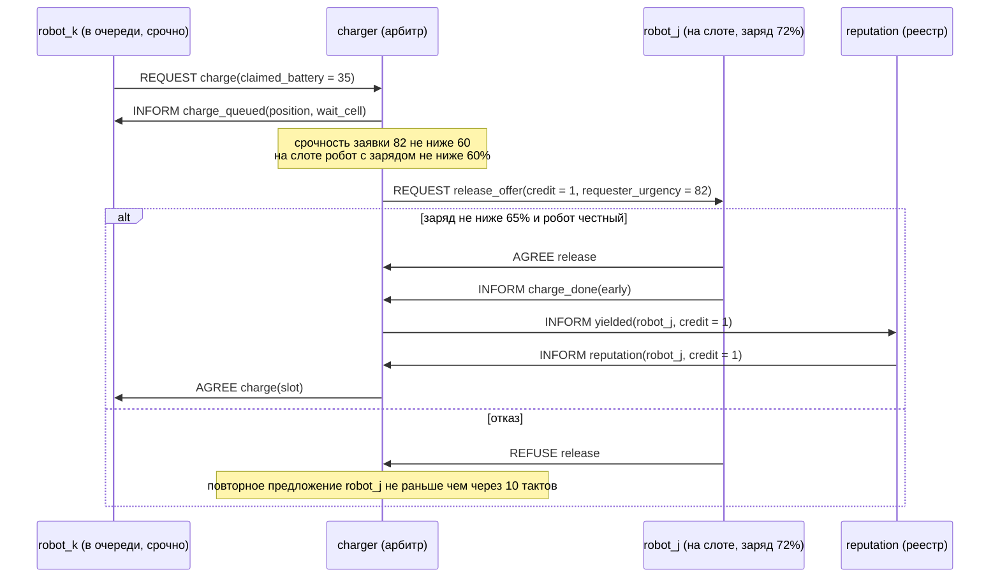
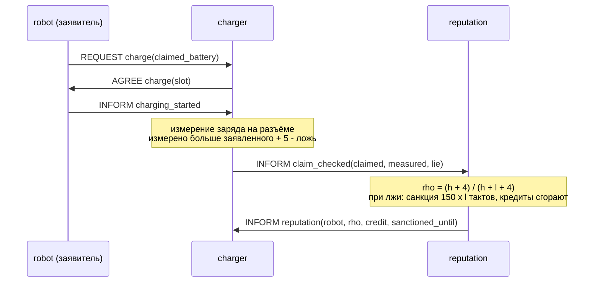
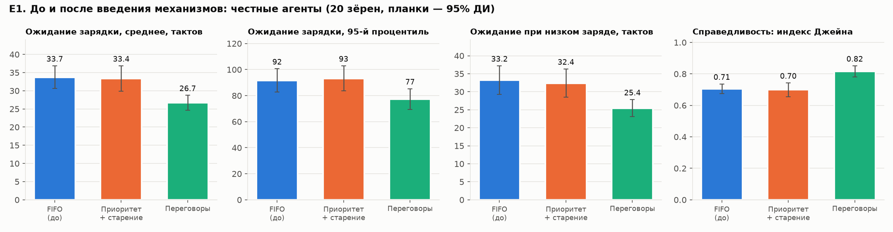
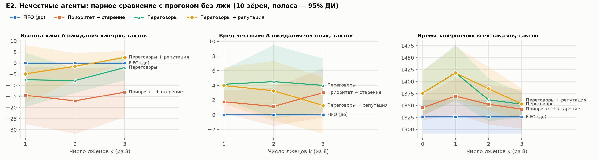
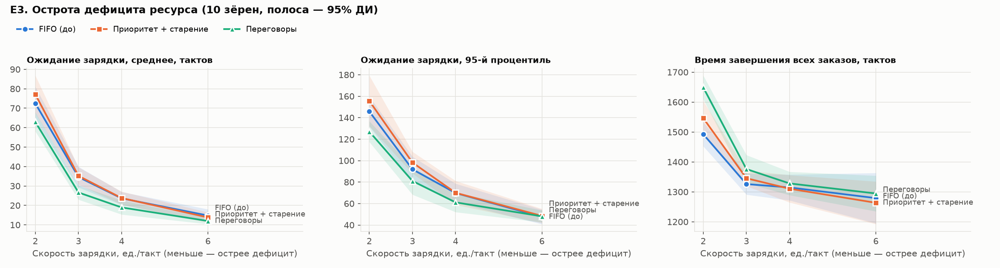
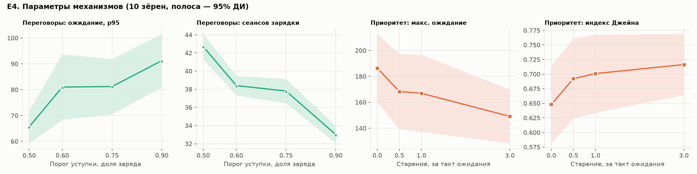

# Лабораторная работа №3
## «Проектирование механизма переговоров и разрешения конфликтов»

**Курс:** Теория многоагентных систем

**Студент:** Малышев Кирилл Борисович, группа Б24-527

**Система:** МАС координации складских роботов (ЛР1), распределение задач — пакетный аукцион (лучший механизм по итогам ЛР2)

**Исходный код, данные и графики:** `warehouse_mas/`, `run.py`, `experiments.py`, `analyze.py`, `results/`, `figures/` (приложения; репозиторий: [github.com/MalyshevKB/multi-agent-syst](https://github.com/MalyshevKB/multi-agent-syst), папка `ЛР3/`)

---

## 1. Ситуация конфликта

### 1.1. Дефицит ресурса

Ресурс — **слоты зарядки**. На складе 8 роботов и 2 зарядные станции по одному слоту. Батарея — 200 единиц, зарядка — 3 единицы за такт, то есть сеанс зарядки длится 30–55 тактов. Суммарная потребность в энергии близка к пропускной способности станций, поэтому к слотам выстраиваются очереди. Каждая минута ожидания — это простаивающий робот.

### 1.2. Конфликт интересов

| Сторона | Интерес |
|---|---|
| Отдельный робот | зарядиться как можно скорее и полностью (до 100 %), вернуться к работе с максимальным запасом |
| Система | максимальная пропускная способность, ни одной разрядки, соблюдение сроков заказов, справедливый доступ к ресурсу |

Интересы расходятся в двух местах:
- **Конкурирующие заявки неравной срочности.** Свободный робот подзаряжается «впрок» при заряде ниже 50 %, а другой робот пришёл почти разряженным. При FIFO первый займёт слот на ~35 тактов, второй будет ждать.
- **Удержание ресурса.** Робот на слоте заинтересован дозарядиться до 100 %, хотя 65–70 % ему уже хватает для работы, а в очереди стоит срочная заявка.

### 1.3. Нечестные агенты

Для проверки устойчивости механизмов вводятся **агенты с подменённой целью** («лжецы»). Такой робот заявляет заряд 5 единиц при любом реальном заряде, чтобы обойти очередь, и **никогда не уступает слот**. Механизм, доверяющий заявленным данным, такой агент может обмануть.

### 1.4. Общесистемные ограничения

| № | Ограничение | Как контролируется |
|---|---|---|
| C1 | Ни один робот не разряжается полностью (`STRANDED`) | счётчик разрядок, минимальный заряд за прогон |
| C2 | Экспресс-заказы (25 %) выполняются за 150 тактов, обычные — за 450 | доля заказов в срок |
| C3 | Слот не удерживается без использования: робот должен подключиться в течение 60 тактов после выдачи | счётчик отзывов слота |
| C4 | Ресурс распределяет только его владелец — станция | полномочия, Λ-правила ЛР1 |
| C5 | Аварийные уходы на зарядку с брошенной задачей минимальны | счётчик аварийных уходов |

### 1.5. Классификация конфликта

| Признак классификации | Тип нашего конфликта | Пояснение |
|---|---|---|
| По структуре | **горизонтальный** | спорят агенты одного ранга и роли — роботы-исполнители. Арбитр (станция) — не сторона конфликта, а механизм его разрешения |
| По информированности участников | **явный (осознанный)** | роботы знают о конкурентах: станция сообщает позицию в очереди и оценку ожидания, поэтому возможны торг и переговоры. До ЛР3 конфликт был отчасти **латентным**: робот, держащий слот до 100 %, не знал, что кто-то в очереди почти разряжен, — это «трагедия общин» в малом масштабе |
| По природе | **ресурсный** (основной) | несколько агентов одновременно запрашивают неделимый ресурс — слот зарядки |
| | **мотивационный** | локальная цель робота «зарядиться полностью и сразу» несовместима с целью системы «максимальная пропускная способность, ни одной разрядки» |
| | **информационный** | у арбитра есть только заявленный заряд; нечестные агенты создают асимметрию информации |
| Сопутствующий | **пространственный** | конфликт траекторий в проходах решён ещё в ЛР1 резервированием клеток и приоритетами (Λ3–Λ7). Это и есть «принцип резервирования (Space-Time Waypoints)»: при пересечении траекторий агент с меньшим приоритетом локальной цели уступает дорогу |

По таблице «стратегии разрешения по типам конфликтов»:
- для **ресурсного** конфликта первичная стратегия — динамическое распределение (приоритетная очередь, переговоры об уступке);
- для **информационного** — верификация (проверка заявленного заряда измерением);
- для **мотивационного** — согласование целей (кредиты взаимности делают уступку выгодной самому роботу).

### 1.6. Формализация конфликта

Пусть $N$ — множество роботов, $R_i$ — доля слот-времени, выделенная роботу $i$, $U_i$ — его локальная полезность.

- **Локальная цель робота:** $\max_{a_i} U_i(a_i, R_i)$, где $U_i$ растёт с зарядом после сеанса и убывает с временем ожидания и простоя. При отсутствии механизма рационально заряжаться до 100 % и не уступать слот.
- **Глобальное ограничение:** $\sum_{i} R_i(t) \le R_{max} = 2$ в каждый момент — не больше двух роботов на слотах. Плюс ограничения C1–C5.
- **Глобальная цель:** $\max \sum_i U_i$ (утилитарное благосостояние: пропускная способность, сроки заказов) при соблюдении C1 «никто не разряжается». Это эгалитарное ограничение: худший робот не должен опускаться до нуля заряда.

Без координирующего механизма локальная оптимизация (каждый держит слот до 100 %) нарушает справедливость доступа: почти разряженный робот ждёт, пока «сытый» дозаряжается. Это и наблюдается при FIFO.

## 2. Механизмы разрешения конфликта

Все механизмы реализованы явно в `agents/charging.py` (станция-арбитр), `agents/reputation.py` (реестр репутации) и `agents/robot.py` (поведение заявителя). Переключаются параметрами `charge_policy` и `reputation`.

### 2.0. Базовое поведение («до»): FIFO

Станция обслуживает очередь в порядке поступления, робот заряжается до 100 %. Так система работала в ЛР1–ЛР2.

### 2.1. Правила приоритезации и арбитраж (`priority`)

Станция выбирает из очереди заявку с наибольшим приоритетом:

$$P_i = U(\hat b_i) + \alpha\cdot w_i,\qquad U(\hat b) = 100\left(1-\frac{\hat b}{B}\right) + 50\cdot[\hat b \le b_{crit}],$$

где
- $\hat b_i$ — **заявленный** роботом заряд, $B = 200$ — ёмкость батареи, $b_{crit} = 40$ (20 %);
- $w_i$ — время ожидания заявки, $\alpha = 1$ — **старение** (aging). Старение — правило защиты от голодания: любая заявка со временем становится первой.

### 2.2. Протокол переговоров о досрочном освобождении слота (`negotiation`)

К приоритезации добавляются переговоры. Если в очереди стоит срочная заявка ($U \ge 60$), станция выбирает заряжающегося робота с наибольшим зарядом (не ниже 60 %) и **предлагает ему уступить слот за кредит взаимности**. Робот решает сам, по своей функции полезности:
- честный робот соглашается, если его заряда уже хватает для работы (≥ 65 %);
- эгоистичный робот отказывается всегда.

После отказа станция выдерживает паузу 10 тактов, прежде чем снова предложить уступку этому же роботу.

**Взаимность.** Кредит за уступку повышает приоритет следующей заявки уступившего робота ($+15$ за кредит) и тратится при получении слота. Так уступать становится выгодно в долгую.

### 2.3. Проверка заявок, репутация и санкции (`negotiation + reputation`)

- **Проверка.** При подключении к слоту станция физически измеряет заряд (датчик на разъёме, а не сообщение робота). В пути заряд может только убывать, поэтому если измеренный заряд больше заявленного более чем на 5 единиц, заявка признаётся ложной.
- **Репутация** ведётся отдельным агентом-реестром `reputation` по бета-модели:

$$\rho_i = \frac{h_i + a_0}{h_i + l_i + a_0},\qquad a_0 = 4,$$

где $h_i$ — подтверждённые заявки, $l_i$ — ложные. Новый агент имеет $\rho = 1$.

- **Учёт недоверия.** Заявленный заряд смещается к «полному» пропорционально недоверию:

$$\tilde b_i = \rho_i\,\hat b_i + (1-\rho_i)\,B .$$

После двух-трёх разоблачений занижение заряда перестаёт давать срочность.

- **Санкция.** После каждой выявленной лжи заявки агента не учитываются $150\cdot l_i$ тактов (срок растёт с числом нарушений), а накопленные кредиты сгорают.
- Реестр рассылает каждое изменение всем станциям (`INFORM reputation`), у станций — локальная копия.

### 2.4. Общие правила, введённые для всех вариантов

Эти правила действуют одинаково в базовом и новых вариантах, поэтому сравнение остаётся честным.

| Правило | Назначение |
|---|---|
| Отзыв слота, если робот не подключился за 60 тактов (C3) | слот не простаивает за роботом, застрявшим в пути |
| Подъезд к слоту и через зону ожидания (ряд 0) | один застрявший робот у слота не отрезает станцию |
| Ожидающий зарядки робот уступает дорогу только при запасе хода | ожидание не тратит заряд |
| Случайная отсрочка при затяжном заторе (шаг в сторону с вероятностью 0,3 после 15 отказов подряд) | разрыв симметричных транспортных тупиков при 8 роботах |
| Экспресс-задачи первыми в лоте аукциона и с бонусом в ставке | приоритезация заказов по сроку (EDF) |

## 3. Методика эксперимента

**Сценарий:** 8 роботов, 100 заказов (p = 0,1 за такт), 25 % экспресс-заказов, 2 станции по 1 слоту, батарея 200, зарядка 3 ед./такт.

**Показатели:**
- **эффективность:** время завершения всех заказов (makespan), среднее и максимальное время заказа, доли экспресс- и обычных заказов в срок;
- **ресурс:** ожидание слота — среднее, 95-й процентиль, максимум; отдельно — ожидание при истинном заряде ≤ 30 %;
- **справедливость:** индекс Джейна по средним ожиданиям роботов, $J=(\sum x_i)^2/(n\sum x_i^2)$; для нечестных агентов — **выгода лжи** и **вред честным**;
- **ограничения:** разрядки, минимальный заряд, аварийные уходы на зарядку, отзывы слота, просроченные заказы.

**Серии:**

| Серия | Что меняется | Зёрен | Прогонов |
|---|---|---|---|
| E1 | «до/после», все честные: FIFO, приоритет, переговоры | 20 | 60 |
| E2 | k ∈ {0, 1, 2, 3} лжецов × 4 варианта (FIFO, приоритет, переговоры, переговоры + репутация) | 10 | 160 |
| E3 | острота дефицита: скорость зарядки 2, 3, 4, 6 ед./такт × 3 варианта | 10 | 120 |
| E4 | порог досрочного освобождения 0,5–0,9 (переговоры); скорость старения 0–3 (приоритет) | 10 | 80 |

Всего 420 прогонов (`python experiments.py`). Обработка (`python analyze.py`):
- среднее ± 95 % ДИ по успешным прогонам; парные разности на одинаковых зёрнах;
- выгода лжи считается **парно**: ожидание тех же роботов при том же зерне и той же политике в прогоне с ложью минус прогон без лжи. Это исключает пространственное смещение: у robot_1 и robot_2 парковки в углах склада, у колонок зарядки, и даже при FIFO они ждут меньше остальных.

Без нечестных агентов вариант «переговоры + репутация» полностью совпадает с «переговорами» (лжи нет, санкций нет), поэтому в E1 он не приводится.

## 4. Результаты

### 4.1. E1 — до и после введения механизмов (все агенты честные)

| Показатель (среднее ± 95 % ДИ) | FIFO (до) | Приоритет + старение | Переговоры |
|---|---|---|---|
| Ожидание зарядки, среднее, тактов | 33,7 ± 3,1 | 33,4 ± 3,5 | **26,7 ± 2,0** |
| Ожидание, 95-й процентиль | 91,7 ± 9,0 | 93,2 ± 9,7 | **77,3 ± 8,0** |
| Ожидание, максимум | 131,8 ± 14,9 | 152,0 ± 19,8 | **117,7 ± 11,6** |
| Ожидание при низком заряде (≤ 30 %) | 33,2 ± 3,9 | 32,4 ± 3,9 | **25,4 ± 2,4** |
| Индекс Джейна по ожиданию | 0,706 ± 0,030 | 0,699 ± 0,044 | **0,815 ± 0,036** |
| Сеансов зарядки | **29,95** | 32,00 | 38,25 |
| Принятых уступок / предложений | — | — | 25,95 / 47,20 |
| Время завершения всех заказов, тактов | **1325 ± 35** | 1448 ± 219 (медиана 1351) | 1387 ± 50 |
| Среднее время заказа, тактов | **194 ± 29** | 268 ± 142 | 217 ± 32 |
| Экспресс-заказы в срок | **0,966** | 0,918 | 0,948 |
| Обычные заказы в срок | **0,861** | 0,828 | 0,803 |
| Аварийных уходов на зарядку | 1,55 | 1,70 | 2,10 |
| Разряженных роботов (за 20 прогонов) | **0** | 2 | 1 |

Парные разности с FIFO на тех же зёрнах:

| Механизм | Δ ожидание, среднее | Δ p95 | Δ при низком заряде | Δ makespan |
|---|---|---|---|---|
| Приоритет + старение | −0,3 ± 3,1 (незначимо) | +1,6 ± 7,7 | −0,8 ± 3,7 | +123 ± 223 (один выброс 3416) |
| Переговоры | **−7,0 ± 2,7** | **−14,3 ± 7,2** | **−7,8 ± 3,3** | **+63 ± 39** |

### 4.2. E2 — нечестные агенты

Выгода лжи (Δ ожидания лжецов) и вред честным (Δ ожидания остальных), тактов на сеанс, парно относительно прогона без лжи:

| Политика | k = 1: лжецы / честные | k = 2: лжецы / честные | k = 3: лжецы / честные | Санкций (k = 3) |
|---|---|---|---|---|
| FIFO | 0,0 / 0,0 | 0,0 / 0,0 | 0,0 / 0,0 | — |
| Приоритет + старение | **−14,5** / +1,8 | **−17,0** / +1,1 | **−13,0** / +3,0 | — |
| Переговоры | −7,5 / +4,2 | −7,9 / +4,5 | −2,1 / +4,0 | — |
| Переговоры + репутация | −4,9 / +4,0 | −1,5 / +3,3 | **+2,6** / +1,3 | 11,4 |

Каждая ложная заявка, по которой лжец подключился к слоту, выявляется при подключении: 3,8 / 7,3 / 11,4 разоблачения за прогон при k = 1 / 2 / 3. Не выявляются только заявки, по которым робот не доехал до слота (слот отозван) или прогон закончился раньше.

Проверка на длинном горизонте (150 заказов, 10 зёрен, k = 2; `python long_horizon.py`), среднее ожидание слота на сеанс, тактов:

| | Ожидание лжецов | Ожидание честных |
|---|---|---|
| Переговоры без репутации | 21,2 | 28,1 |
| Переговоры + репутация | **33,3** | 27,2 |

### 4.3. E3 — острота дефицита

| Скорость зарядки | Ожидание, среднее: FIFO / приоритет / переговоры | p95: FIFO / переговоры | Makespan: FIFO / переговоры |
|---|---|---|---|
| 2 (острый дефицит) | 72,5 / 77,1 / **62,9** | 146 / **127** | **1493** / 1649 |
| 3 (базовый) | 34,6 / 35,2 / **26,6** | 92 / **81** | **1326** / 1376 |
| 4 | 23,6 / 23,8 / **19,0** | 70 / **61** | **1315** / 1328 |
| 6 (мягкий) | 14,8 / 13,8 / **12,0** | 48 / 48 | 1279 / 1294 |

При скорости 2 вариант «приоритет» дал 9 разрядок в 4 прогонах из 10 (6 из них — в одном прогоне, который не завершился); FIFO и переговоры — ни одной. При мягком дефиците (скорость 6) отмечены единичные разрядки у FIFO (3) и приоритета (2), у переговоров — ни одной; при скорости 4 — одна у переговоров.

### 4.4. E4 — параметры механизмов

| Порог уступки (доля заряда) | 0,5 | 0,6 | 0,75 | 0,9 |
|---|---|---|---|---|
| Ожидание, p95 | **66** | 81 | 81 | 91 |
| Сеансов зарядки | 42,7 | 38,4 | 37,8 | **33,0** |

| Старение α | 0 | 0,5 | 1 | 3 |
|---|---|---|---|---|
| Максимальное ожидание | 186 | 168 | 167 | **149** |
| Индекс Джейна | 0,648 | 0,692 | 0,701 | **0,716** |

## 5. Анализ

### 5.1. Приоритезация сама по себе не помогает и делает систему уязвимой

- В честной системе приоритетная очередь ничего не изменила: −0,3 ± 3,1 такта. Роботы приходят на зарядку с похожим зарядом (30–50 %), очередь редко длиннее двух, и порядок обслуживания почти совпадает с FIFO.
- Зато этот механизм **не стимулирует правдивость**: он доверяет заявленным данным. Лжец, заявивший 5 единиц, обходит очередь и выигрывает 13–17 тактов на сеанс, а честные теряют 1–3 такта.
- Рациональный агент при таком механизме должен лгать. Такое правило нельзя вводить без проверки заявок.

### 5.2. Переговоры улучшают доступ к ресурсу и справедливость, но за счёт пропускной способности

Механизм переговоров добился главного: время ожидания слота сокращено по всем статистикам:

| Статистика ожидания | Изменение |
|---|---|
| Среднее | −21 % |
| 95-й процентиль | −16 % |
| Максимум | −11 % |
| При низком заряде | −24 % |

Справедливость доступа выросла: индекс Джейна 0,71 → 0,82 (+16 %). Улучшение сохраняется при любой остроте дефицита (E3).

**Цена — лишние поездки к станциям.** Уступивший робот уезжает с 65–75 % заряда и раньше возвращается:
- сеансов зарядки на 28 % больше (38 против 30);
- время выполнения всех заказов на 4,7 % больше (+63 ± 39 такта, значимо);
- доля обычных заказов в срок ниже: 0,80 против 0,86.

Цена тем выше, чем острее дефицит: при скорости зарядки 2 makespan +10 %. Это классический компромисс «справедливость и время реакции ↔ эффективность». Им можно управлять порогом уступки (E4): при пороге 0,9 сеансов почти столько же, сколько при FIFO (33), но и выигрыш в ожидании меньше.

### 5.3. Репутация и санкции делают ложь невыгодной

1. **FIFO — контрольная группа.** Заявленный заряд при FIFO не используется, и прогоны с ложью совпадают с честными до такта (Δ = 0). Это подтверждает корректность парной методики.
2. **Без репутации ложь окупается:** лжецы ждут на 2–8 тактов меньше, честные — на ~4 такта больше. Нечестный агент перекладывает ожидание на честных.
3. **С репутацией выгода лжи падает с ростом числа разоблачений:** −4,9 при k = 1 → −1,5 при k = 2 → **+2,6** при k = 3 (ложь начинает вредить самому лжецу). Вред честным снижается до +1,3.
   - На длинном горизонте (150 заказов) ложь с репутацией прямо невыгодна: лжецы ждут на 22 % **дольше** честных (33,3 против 27,2), а без репутации — на 24 % меньше (21,2 против 28,1).
   - Доверительные интервалы E2 широкие (10 зёрен, по 3–4 заявки от каждого лжеца), поэтому на коротком горизонте результат — уверенная тенденция, а не строгая значимость.
4. **Почему первая ложь всё равно окупается.** Проверка происходит при подключении, то есть уже после того, как лжец прошёл без очереди. Санкция действует только на следующие заявки. Устранить остаточную выгоду можно предварительной проверкой: запросом телеметрии до выдачи слота. Это кандидат на защитное ограничение в ЛР4.
5. **При разработке выявлено:** простое взвешивание срочности репутацией (U × ρ) не работает. Лжец с ρ = 0,5 всё равно имеет срочность 150 × 0,5 = 75 — больше, чем честный робот (~65). Поэтому выбрано смещение заявки к «полному заряду» и эскалация срока санкции.

### 5.4. Соблюдение общесистемных ограничений

- **C1 (разрядки):** в базовом сценарии 0–2 случая на 20 прогонов во всех вариантах. Исключение — приоритет при остром дефиците (9 разрядок в 4 прогонах из 10, один прогон не завершился): заявки с невысокой срочностью при чистом приоритете ждут слишком долго.
- **C2 (сроки):** экспресс-заказы выполняются в срок в 92–97 % случаев при всех механизмах благодаря EDF-приоритезации в аукционе. Переговоры снижают долю обычных заказов в срок из-за потери пропускной способности.
- **C3 (удержание слота):** отзывов слота за прогон — 0,25 (FIFO), 1,85 (приоритет), 0,75 (переговоры). Без этого правила при прототипировании станция однажды простояла 600 тактов.
- **Найденная уязвимость.** В одном прогоне E2 (переговоры + репутация, k = 1, зерно 3) лжец 52 раза получал слот по ложной срочности, не успевал подключиться (слот отзывался) и тут же подавал новую заявку. Проверка заявки происходит только при подключении, поэтому санкция не наступала, а слот раз за разом простаивал. Это сценарий для ЛР4: «отказ в обслуживании через ложные заявки». Защита — учитывать отзыв слота как нарушение и ограничить частоту заявок. Отзывы бывают и у честных роботов: в прогоне k = 3, зерно 2, честный `robot_5` застрял на подъезде, и слот отзывался 58 раз — правило C3 не давало ему держать слот, но и не устраняло причину.
- **Старение (E4)** — необходимое правило справедливости: без него (α = 0) максимальное ожидание 186 тактов и индекс Джейна 0,65; при α = 3 — 149 и 0,72.

### 5.5. Проблемы, выявленные при прототипировании

| Проблема | Решение |
|---|---|
| При одной станции на 8 роботов система разваливается от заторов у единственного подъезда; переговоры, добавляющие поездки, ускоряют развал | дефицит смоделирован через длительность зарядки, а не через число подъездов (2 станции, батарея 200, 3 ед./такт) |
| Робот, разрядившийся перед слотом, отрезал станцию; выданный слот простаивал сотни тактов | второй подъезд через зону ожидания и отзыв слота через 60 тактов (C3) |
| Ожидающие без места ожидания стояли в проходах и разряжались, уступая дорогу | места ожидания по числу роботов; уступка только при запасе хода |
| Заявленная срочность почти одинакова у всех — арбитру нечего решать | подзарядка «впрок» свободных роботов (ниже 50 %) создаёт заявки разной срочности |

### 5.6. Механизмы в терминах теории переговоров и доверия

**Соответствие реализованного теоретическим понятиям:**

| Понятие | Где у нас | Комментарий |
|---|---|---|
| **Арбитраж**: третья сторона с высшим приоритетом директивно распределяет ресурс | станция зарядки — арбитр ресурса | арбитр использует не арбитраж Нэша, а правило приоритета со старением — вычислимое за O(очередь) и прозрачное для агентов |
| **Медиация** (фасилитатор предлагает компромисс, но не решает) | предложение `release_offer` | станция лишь *предлагает* уступку, решает сам заряжающийся робот — это медиация, а не директива |
| **Уступки на основе долгосрочной репутации, «кредиты доверия»** | кредиты взаимности за уступку слота | дословная реализация: робот уступает сейчас в расчёте на приоритет потом; баланс ведёт реестр |
| **Бета-модель репутации**: $E=\frac{r+1}{r+s+2}$ | $\rho=\frac{h+a_0}{h+l+a_0}$ | то же бета-ожидание, но с более сильным априорным доверием ($a_0=4$ вместо 1/2): новичок полностью доверен, а не «50 на 50». Это сознательный выбор: все роботы — участники с известной историей, а не анонимы открытой сети |
| **Источники доверия** | прямое измерение станцией | используется самый надёжный источник — **прямая проверка** (измерение заряда на разъёме), а не свидетельства других агентов, поэтому клевета и сговор свидетелей невозможны |
| **Хранение репутации** | централизованный реестр `reputation` с копиями у станций | это единая точка отказа и цензуры; приемлемо в закрытой системе склада, но это уязвимость для ЛР4 |
| **Виды санкций** | структурная: заявки нарушителя не учитываются $150 \cdot l$ тактов; репутационная: снижение $\rho$; экономическая: сгорание кредитов; позитивная: кредит за уступку | эскалация срока санкции соответствует «быстрому обнулению репутации при серьёзном нарушении» — защите от атаки «хамелеона» |
| **Контроль соблюдения** | **реактивный (принуждение через санкции)** | ложь физически возможна, но обнаруживается и наказывается. Альтернатива — **регламентация** (запрашивать телеметрию заряда *до* выдачи слота) — исключила бы и выгоду первой лжи |
| **Совместимость стимулов** | приоритет по заявленным данным её **нарушает** | ровно «совет архитектору механизмов»: мы «попробовали обмануть свою систему» (серия E2), и при `priority` ложь выгодна (−13…−17 тактов). С репутацией ложь становится невыгодной (+2,6 при k = 3) |
| **Репутационный залог**: потери от падения репутации должны превышать сиюминутную выгоду обмана | эскалирующие санкции | проверено эмпирически: на длинном горизонте ложь становится невыгодной (лжецы ждут 33,3 такта против 27,2 у честных) |
| **Индивидуальная рациональность** | честный робот уступает слот только при заряде ≥ 65 % | участие в переговорах не ухудшает положение робота ниже рабочего уровня, поэтому соглашаться ему рационально |

**Угрозы репутационным механизмам:**
- **атака Сивиллы и «отмывание»** — неприменимы: идентификаторы роботов фиксированы, перерегистрироваться нельзя;
- **сговор и накрутка, клевета** — неприменимы: оценки ставит не агент агенту, а станция по измерению;
- **атака «хамелеона»** — актуальна (честно накопить доверие, потом лгать). Ослаблена эскалацией санкций, но первая ложь после периода честности снова окупается: $\rho$ к этому моменту близка к 1.

**Не реализованные методы и почему:**

| Метод | Почему не применён |
|---|---|
| Вектор Шепли | для справедливого деления *выигрыша коалиции*; у нас нет коалиций и делимого выигрыша — слот неделим, а время на нём уже делится очередью и уступками. К тому же сложность $2^n$ |
| Торг Рубинштейна | для двустороннего деления «пирога» с дисконтированием; у нас многосторонняя очередь, а многораундовый торг добавил бы задержку при каждой выдаче слота («пока агенты торгуются, среда меняется») |
| Арбитраж Нэша $\max\prod (U_i - U_i^{conflict})$ | требует знать функции полезности агентов; у арбитра есть только заявленный заряд, который может быть ложным |
| VCG / аукцион второй цены | дал бы совместимость стимулов «по построению», но требует внутренней валюты и платежей. Мы получили ту же правдивость через проверку и репутацию, без денег |
| Налоги Пигу | ближайший аналог у нас — санкция за удержание выданного, но неиспользуемого слота (отзыв через 60 тактов, C3); полноценной платы за внешние эффекты нет |

**Цена анархии (оценка).** По определению $PoA = \frac{\text{глобальный максимум}}{\text{худшее равновесие}}$. Эгоистичное поведение без механизма (все лгут, никто не уступает) мы прямо не моделировали. Но вред от лжецов наблюдаем. При переговорах без репутации каждый честный робот ждёт на +4,0…4,5 такта дольше. С механизмом репутации это +4,0 / +3,3 / +1,3 такта при k = 1 / 2 / 3: чем больше лжи, тем быстрее она разоблачается. Это и есть цель проектирования механизмов — приблизить $PoA$ к 1.

## 6. Выводы

1. Смоделирован конфликт интересов за дефицитный ресурс (слоты зарядки) между индивидуальной рациональностью роботов и общесистемными целями.
   - По классификации он горизонтальный, явный, ресурсный с мотивационной и информационной составляющими.
   - Формализован как $\max U_i$ при $\sum R_i \le R_{max}$.
   - Добавлены нечестные агенты, занижающие заявленный заряд.
2. Реализованы три механизма поверх базового FIFO:
   - арбитраж по приоритету со старением;
   - протокол переговоров о досрочном освобождении слота с кредитами взаимности;
   - проверка заявок с бета-репутацией и эскалирующими санкциями.
   
   Проведено 420 прогонов в четырёх сериях.
3. **Приоритезация по заявленным данным** без проверки не дала выигрыша в честной системе и сделала ложь выгодной (−13…−17 тактов ожидания лжецу). Механизм нарушает **совместимость стимулов** (incentive compatibility).
4. **Переговоры** сократили ожидание слота на 16–24 % и повысили справедливость доступа (индекс Джейна +16 %). Цена — на 28 % больше сеансов зарядки и на 4,7 % больше общее время выполнения. Компромисс регулируется порогом уступки.
5. **Репутация с санкциями** устраняет выгоду лжи: на длинном горизонте лжецы ждут на 22 % дольше честных, без репутации — на 24 % меньше. При большем числе нарушений ложь становится невыгодной самому лжецу (устойчивая тенденция на 10 зёрнах; при k = 3 интервал +2,6 ± 2,9 ещё захватывает ноль), а вред честным агентам снижается в 3 раза.
   - В терминах теории это бета-модель репутации с прямым источником доверия (измерение), структурными, репутационными и экономическими санкциями и реактивным контролем (принуждение).
   - Кредиты взаимности реализуют «уступки на основе долгосрочной репутации».
   - Остаточная выгода первой лжи — следствие реактивного, а не превентивного контроля. Направление защиты для ЛР4 — регламентация: проверка до выдачи ресурса.
6. Рекомендуемая конфигурация:
   - переговоры + репутация;
   - порог уступки 0,6–0,75;
   - старение α ≥ 1;
   - обязательная проверка заявок.

---

**Приложения** (не входят в отчёт): исходный код `warehouse_mas/`, сценарии `run.py`, `experiments.py`, `analyze.py`, `long_horizon.py`; данные `results/E1–E4.csv`; полные таблицы `results/summary.md`; графики `figures/`.
