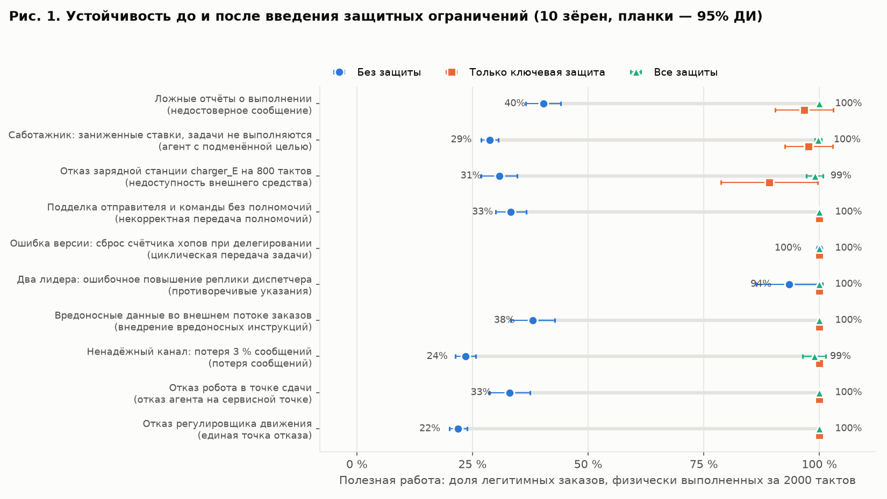
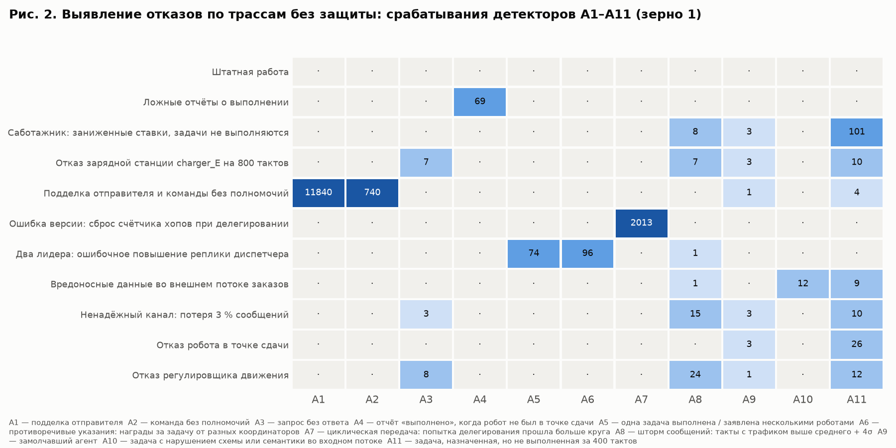
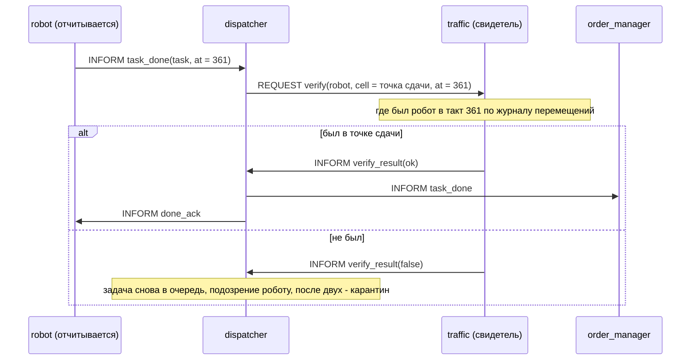
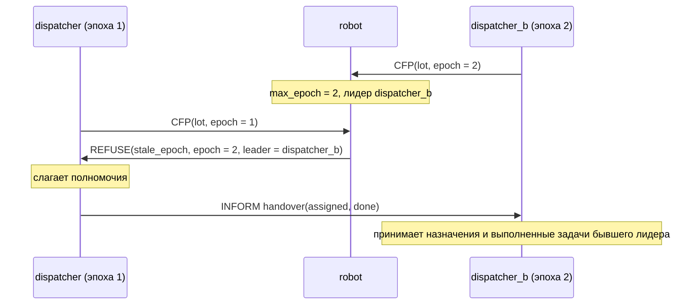

# Лабораторная работа №4
## «Диверсионный анализ и оценка надёжности многоагентной системы»

**Курс:** Теория многоагентных систем

**Студент:** Малышев Кирилл Борисович, группа Б24-527

**Система:** МАС координации складских роботов (ЛР1). Распределение задач — пакетный аукцион (ЛР2), разрешение конфликта за зарядку — переговоры с репутацией (ЛР3)

**Исходный код, данные, трассы и графики:** `warehouse_mas/`, `run.py`, `experiments.py`, `analyze.py`, `results/`, `figures/` (приложения; репозиторий: [github.com/MalyshevKB/multi-agent-syst](https://github.com/MalyshevKB/multi-agent-syst), папка `ЛР4/`)

---

## 1. Цель и методика

**Цель:**
1. разработать набор неблагоприятных сценариев для созданной МАС;
2. собрать трассы выполнения и выявить по ним отказы;
3. ввести защитные ограничения и повторно оценить устойчивость.

**Объект.** Конфигурация, рекомендованная по итогам ЛР2–ЛР3: 8 роботов, 100 заказов, пакетный аукцион, переговоры о слотах зарядки с репутацией.

**Порядок работы для каждого сценария:**
1. **Без защиты** — фиксируются последствия.
2. **Трасса** — агент `monitor` пишет все сообщения. Анализатор `trace_analysis.py` ищет аномалии **только по трассе**, без доступа к внутреннему состоянию агентов, как внешний аудитор.
3. **Со всеми защитными ограничениями** и **только с ключевой защитой** — повторная оценка.

### 1.1. Как измерялась надёжность

Главная трудность — не доверять самой системе. В одном из сценариев система сообщает «выполнено 100 из 100», а на деле выполнено 40. Поэтому основные показатели считаются по **физической истине**, а не по сообщениям:

| Показатель | Определение |
|---|---|
| **Полезная работа** (goodput) | доля легитимных заказов, все позиции которых **физически сданы** на станцию за 2000 тактов (в штатной работе система укладывается в ~1400) |
| Ложно выполненные заказы | система отчиталась о выполнении, но товар физически не сдан |
| Повторные выполнения | одна позиция физически привезена больше одного раза (напрасная работа) |
| Столкновения | два робота в одной клетке (нарушение инварианта безопасности) |
| Падения агентов | агент вышел из строя из-за исключения при обработке сообщения |
| Разряженные роботы | полный разряд в пути |
| Сообщения, пик сообщений за такт | стоимость и «штормовость» |

Каждый вариант прогонялся на 10 зёрнах, то есть было 10 прогонов. Всего 340 прогонов (`python experiments.py`, ~30 с).

## 2. Набор неблагоприятных сценариев

Отказы внедряются на 300-м такте, когда система уже работает в установившемся режиме (`warehouse_mas/faults.py`).

| № | Сценарий (id) | Класс по заданию | Что происходит |
|---|---|---|---|
| S1 | `false_done` | недостоверное сообщение | robot_3 сообщает «задача выполнена», не выполняя её |
| S2 | `saboteur` | агент с подменённой целью | robot_3 ставит в аукционе стоимость 1 на все задачи, заявляет 10 свободных мест, копит выигранные задачи и не выполняет их |
| S3 | `station_outage` | недоступность внешнего средства | зарядная станция `charger_E` недоступна 800 тактов (сообщения к ней теряются) |
| S4 | `spoofing` | некорректная передача полномочий | скомпрометированный узел шлёт сообщения от чужого имени: «иди заряжаться» от диспетчера, «уступи слот» от станции, «зарядка окончена» от робота. Плюс команды от своего имени, на которые у него нет полномочий |
| S5 | `delegation_loop` | циклическая передача задачи | в режиме делегирования (ЛР2) у robot_3 ошибка версии протокола: при пересылке он сбрасывает счётчик переходов, и задача может ходить по кольцу бесконечно |
| S6 | `split_brain` | противоречивые указания | реплика диспетчера ошибочно повышена до лидера при живом лидере: два координатора одновременно раздают одни и те же задачи |
| S7 | `injection` | внедрение вредоносных инструкций | 15 % заказов из внешнего потока содержат вредоносную нагрузку: координаты списком вместо кортежа («отравленное» сообщение), недостижимая точка (99, 99), точка сдачи на слоте зарядки |
| S8 | `msg_loss` | потеря сообщений | канал теряет 3 % сообщений |
| S9 | `service_crash` | отказ агента на сервисной точке | robot_3 отказывает, стоя в точке сдачи станции упаковки (найдено в ЛР1) |
| S10 | `traffic_crash` | единая точка отказа | отказывает регулировщик движения — единственный агент, выдающий разрешения на перемещение |

**Тип отказа**. В терминах задачи византийских генералов сценарии делятся на две группы.
- **Византийские отказы** (агент работает, но шлёт ложные или противоречивые данные, саботирует): S1 (ложные отчёты), S2 (саботажник с ложными ставками), S4 (подделка и самоуправство), S6 (лидер, раздающий противоречивые указания), S7 (вредоносные данные извне — аналог «отравления данных» и промпт-инъекций).
- **Отказы-остановки** (crash: агент или средство замолкает или физически застревает): S3, S9, S10, а также S8 (потеря сообщений) и S5 (ошибка протокола без злого умысла).

Это деление определяет защиту: остановки обнаруживаются по молчанию (тайм-ауты, сигналы живости, резервирование), а византийские отказы — только **сверкой с независимым источником** (свидетель, датчик, проверка полномочий).

## 3. Результаты без защиты



| Сценарий | Полезная работа | Что сломалось |
|---|---|---|
| Штатная работа | 100 % | — |
| S1 ложные отчёты | **40 %** | 596 заказов за 10 прогонов **ложно** отмечены выполненными. Система «видит» 100 % при фактических 40 % |
| S2 саботажник | **29 %** | задачи «проваливаются» в саботажника, заказы не завершаются |
| S3 отказ станции | **31 %** | роботы бесконечно ждут ответа от недоступной станции |
| S4 подделка | **33 %** | роботов снимают с работы и выгоняют со слотов; ~90 тыс. сообщений (в 3,2 раза больше нормы) |
| S5 петля делегирования | 100 % | задача проходит до 14 переходов вместо 7, сообщений +19 %; заказы выполняются |
| S6 два лидера | 94 % | **1051** повторное выполнение за 10 прогонов, время выполнения +49 % (2070 против 1389) |
| S7 вредоносные данные | **38 %** | 30 падений агентов: одно «отравленное» сообщение роняет каждого робота, участвующего в аукционе |
| S8 потеря сообщений | **24 %** | одна потеря «навсегда» вешает робота, заявку или отчёт |
| S9 отказ на сервисной точке | **33 %** | все заказы станции, в точке сдачи которой стоит отказавший робот, невыполнимы |
| S10 отказ регулировщика | **22 %** | без разрешений на движение весь парк встаёт |

Главный вывод: **9 из 10 сценариев выводят систему из строя**. В восьми (S1–S4, S7–S10) полезная работа падает до 22–40 %; в S6 заказы выполняются (94 %), но нарушена целостность — 1051 повторное выполнение и +49 % времени. Только S5 система переносит без потерь, ценой +19 % сообщений. Причём в половине случаев внешне это не заметно: система не падает, а «молча» простаивает или отчитывается о несделанном.

## 4. Выявление отказов по трассам

Анализатор применяет к трассе 11 детекторов. Это правила, выведенные из спецификации протоколов ЛР1:

| Детектор | Признак в трассе |
|---|---|
| A1 | подделка отправителя: поле `from` не совпадает с источником, проставленным шиной |
| A2 | команда без полномочий (матрица полномочий ЛР1, п. 2.5) |
| A3 | запрос, на который протокол обязывает ответить, остался без ответа 5 тактов |
| A4 | отчёт «выполнено», когда робот, по трассе перемещений, не был в точке сдачи |
| A5 | одна задача заявлена выполненной несколькими роботами |
| A6 | награды за одну задачу от разных координаторов |
| A7 | попытка делегирования прошла больше полного круга |
| A8 | шторм: такты с трафиком выше среднего + 4σ |
| A9 | замолчавший агент |
| A10 | задача с нарушением схемы или семантики во входном потоке |
| A11 | задача назначена, но не выполнена за 400 тактов |



Матрица «сценарий × детектор» почти диагональная: **каждый сценарий даёт свой характерный сигнал, а в штатной работе нет ни одного срабатывания** (ложных тревог 0).

| Сценарий | Сигнатура в трассе |
|---|---|
| S1 | A4 = 69 отчётов «выполнено», когда робот был в другом месте |
| S2 | A11 = 101 зависшая задача |
| S3 | A3 = 7 запросов к станции без ответа + A9 замолчавшая станция + A11 |
| S4 | A1 = 11 840 подделок, A2 = 740 команд без полномочий |
| S5 | A7 = 2013 попыток делегирования длиннее круга |
| S6 | A6 = 96 задач с наградами от двух координаторов, A5 = 74 задачи у нескольких исполнителей |
| S7 | A10 = 12 вредоносных задач во входном потоке |
| S8 | A3, A8, A11 — потерянные ответы и зависшие задачи |
| S9 | A9 + A11 = 26 задач у станции, заблокированной отказавшим роботом |
| S10 | A3 (запросы к регулировщику без ответа) + A9 (замолчал `traffic`) |

Выдержки трасс по первым аномалиям каждого сценария — в `results/traces/*_off.jsonl`. Пример подделки (S4):

```
{"tick": 300, "from": "dispatcher", "origin": "adversary", "to": "robot_1", "performative": "request",
 "content": {"action": "recharge", "epoch": 99}, "detector": "A1_spoofed"}
```

Пример петли (S5): одна попытка `dispatcher:86` с переходами `robot_6 → robot_7 → robot_8 → robot_1 → … → robot_3`, после которого счётчик `hops` снова равен 0.

## 5. Защитные ограничения

Введено 10 защитных механизмов. Каждый включается отдельно, параметр `defenses`.

| Защита | Где | Что делает | Против |
|---|---|---|---|
| `auth` | все агенты (`Agent.receive`) | шина проставляет неподделываемое поле `origin`; сообщение с `origin ≠ from` отбрасывается; проверяется **матрица полномочий** (`security.py`, по таблице ЛР1 п. 2.5) | S4 |
| `validate` | менеджер заказов, диспетчер | проверка **схемы** (строгие типы: координаты — кортеж двух `int`) и **семантики** (стеллаж существует, точка подбора — его, точка сдачи — станции, корректный срок); заказ с нарушением — в карантин | S7 |
| `contain` | все агенты | исключение в обработчике не роняет агента: сообщение отбрасывается, ошибка журналируется | S7 |
| `verify_done` | диспетчер + регулировщик | отчёт «выполнено» засчитывается только после подтверждения **независимым свидетелем**: регулировщик сверяет положение робота в такт заявленной сдачи. Ложь — подозрение, после двух — карантин | S1 |
| `watchdog` | диспетчер | проверка **правдоподобия ставок** (ставка ниже физически возможной стоимости — отклоняется); отзыв задач, не выполненных за max(300, 4 × ставка) тактов; карантин исполнителя; **предохранитель**: в карантине не больше ¼ парка | S2 |
| `timeouts` | все протоколы | тайм-ауты и повторы с подтверждениями **на каждом участке**: «менеджер → диспетчер», «робот → диспетчер», «диспетчер → менеджер»; keepalive от станций; повтор резервирования клетки; маяк положения; идемпотентная обработка повторов; **сверка с датчиком присутствия на слоте** (утечка слота) | S3, S8 |
| `ttl` | роботы, диспетчер | идентификатор каждой попытки делегирования; робот, получивший ту же попытку второй раз, возвращает задачу как петлю; принятие устаревшей попытки отзывается | S5 |
| `fencing` | роботы, диспетчер | **эпохи лидерства**: команды координатора с эпохой ниже максимальной увиденной отвергаются; устаревший лидер слагает полномочия и **передаёт дела** новому | S6 |
| `evacuation` | монитор, станции, служба `maintenance` | отказавший или разряженный робот физически убирается с поля; станция вызывает эвакуацию робота, **захватившего слот** (стоит на слоте, который ему не выдан, дольше 80 тактов) | S9, S2 |
| `standby` | монитор, `traffic_b` | **горячий резерв** регулировщика: монитор следит за его сигналом живости и при молчании дольше 15 тактов повышает резерв; роботы переключаются и сообщают свои положения | S10 |

Как работают две ключевые защиты — сверка со свидетелем и эпохи лидерства:





## 6. Повторная оценка устойчивости

### 6.1. Полезная работа

| Сценарий | Без защиты | Только ключевая защита | Все защиты |
|---|---|---|---|
| S1 ложные отчёты | 0,40 ± 0,04 | 0,97 ± 0,06 | **1,00 ± 0,00** |
| S2 саботажник | 0,29 ± 0,02 | 0,98 ± 0,05 | **1,00 ± 0,01** |
| S3 отказ станции | 0,31 ± 0,04 | 0,89 ± 0,10 | **0,99 ± 0,02** |
| S4 подделка | 0,33 ± 0,03 | **1,00** | **1,00** |
| S5 петля делегирования | 1,00 | 1,00 | 1,00 |
| S6 два лидера | 0,94 ± 0,07 | **1,00** | **1,00** |
| S7 вредоносные данные | 0,38 ± 0,05 | **1,00** | **1,00** |
| S8 потеря сообщений | 0,24 ± 0,02 | **1,00 ± 0,00** | 0,99 ± 0,02 |
| S9 отказ на сервисной точке | 0,33 ± 0,04 | **1,00** | **1,00** |
| S10 отказ регулировщика | 0,22 ± 0,02 | **1,00** | **1,00** |

### 6.2. Нарушения целостности и безопасности (сумма за 10 прогонов: без защиты → все защиты)

| Сценарий | Ложно выполненные | Повторные выполнения | Падения агентов | Столкновения | Разряжено | Сообщений (ср.) | Время выполнения всех |
|---|---|---|---|---|---|---|---|
| Штатная работа | 0 → 0 | 0 → 0 | 0 → 0 | 0 → 0 | 0 → 1 | 28 367 → 30 936 | 1389 → 1365 |
| S1 | **596 → 0** | 0 → 3 | 0 → 0 | 0 → 0 | 0 → 0 | 21 523 → 32 191 | не завершено → 1484 |
| S2 | 0 → 0 | 0 → 0 | 0 → 0 | 0 → 0 | 0 → 1 | 25 164 → 36 050 | не завершено → 1545 (по 9 прогонам; в одном не все заказы выполнены) |
| S3 | 0 → 0 | 0 → 0 | 0 → 0 | 0 → 0 | 4 → 7 | 37 664 → 35 531 | не завершено → 1900 |
| S4 | 0 → 0 | 0 → 0 | 0 → 0 | 0 → 0 | 5 → 1 | **90 242 → 34 544** | не завершено → 1364 |
| S5 | 0 → 0 | 0 → 0 | 0 → 0 | 0 → 1 | 1 → 1 | 65 794 → 60 566 | 1485 → 1463 |
| S6 | 0 → 0 | **1051 → 9** | 0 → 0 | 0 → 0 | 4 → 1 | 48 477 → 32 094 | 2070 → 1377 |
| S7 | 0 → 0 | 0 → 0 | **30 → 0** | 2 → 0 | 12 → 0 | 46 644 → 28 062 | не завершено → 1222 |
| S8 | 0 → 0 | 0 → 46 | 0 → 0 | 1 → 4 | 0 → 0 | 24 147 → 36 230 | не завершено → 1745 |
| S9 | 0 → 0 | 0 → 0 | 0 → 0 | 3 → 0 | 10 → 0 | 75 923 → 31 002 | не завершено → 1457 |
| S10 | 0 → 0 | 0 → 2 | 0 → 0 | 0 → 0 | 0 → 0 | 24 573 → 31 470 | не завершено → 1376 |

Как защиты срабатывали (среднее за прогон, все защиты):

| Сценарий | Срабатывания |
|---|---|
| S1 | отклонено 41,7 ложного отчёта, 2 карантина |
| S2 | отклонено 17,9 неправдоподобной ставки, 1,9 карантина, 0,5 эвакуации захватчика слота |
| S3 | 1,1 эвакуации (0,7 — разряженные роботы, 0,4 — захватчики слота), 0,8 исправленной утечки слота |
| S4 | отброшено ~3600 поддельных сообщений и команд без полномочий |
| S5 | обнаружено ~2560 петель, максимальная длина круга 8 (вместо 14) |
| S6 | 6,6 отказа по устаревшей эпохе, 1 сложение полномочий с передачей дел |
| S7 | 10,5 заказа в карантине |
| S8 | 11,7 тайм-аута подтверждения награды, 0,8 исправленной утечки слота; побочный эффект — 26,7 отклонённого честного отчёта и 2,3 карантина (п. 7.3) |
| S9 | 1 эвакуация |
| S10 | 1 переключение на резервный регулировщик; также 1,2 отклонённого отчёта и 0,2 карантина за прогон |

### 6.3. Стоимость защиты в штатной работе

| | Без защиты | Все защиты |
|---|---|---|
| Время выполнения всех заказов | 1389 ± 49 | 1365 ± 43 (разница в пределах ДИ) |
| Сообщений | 28 367 | 30 936 (**+9 %**: подтверждения, keepalive, маяки, сверка, сигналы живости) |
| Пик сообщений за такт | 47 | 60 |
| Ложные срабатывания защит | — | 0,2 эвакуации за прогон: в одном прогоне эвакуирован робот, разрядившийся в заторе, в другом — честный робот, простоявший на невыданном слоте дольше 80 тактов |

Защита почти бесплатна в нормальном режиме: около +9 % трафика без потери производительности.

## 7. Анализ

### 7.1. Какие отказы опаснее всего

1. **«Тихие» отказы опаснее «громких».** Худшие сценарии (S1, S2, S3, S8) не роняют ни одного агента. Система продолжает «работать», но простаивает или отчитывается о несделанном. В S1 система рапортует 100 %, фактически выполнено 40 %. Обнаружить такой отказ можно только сверкой с физической реальностью: свидетелем, журналом перемещений, датчиком.
2. **Протоколы без тайм-аутов — главная уязвимость МАС.** В ЛР1–ЛР3 каждое ожидание ответа было бесконечным. Одна потеря из 33 сообщений (S8), одна недоступная станция (S3) или регулировщик (S10) и вешают систему.
3. **Доверие к самооценке агента эксплуатируется сразу.** Аукцион (ЛР2) доверяет ставке, а переговоры (ЛР3) — заявке. Саботажник со ставкой «1» выигрывает всё (S2). Защита — проверка правдоподобия по физической нижней границе стоимости.
4. **Единые точки отказа подтверждены экспериментально.** Регулировщик (S10, полезная работа 22 %), сервисная точка (S9, 33 %) и лидер-координатор (S6, тысяча повторных выполнений) — ровно те узлы, на которые указывал граф коммуникаций ЛР1.
5. **Неожиданно устойчивым оказалось делегирование (S5).** Задачу из петли «вылавливает» уже существующий тайм-аут делегирования из ЛР2, а первый свободный робот её забирает. Ошибка видна только по трассе (A7) и по росту сообщений на 19 %.

### 7.2. Защиты сами порождают отказы

Самый ценный результат работы: при введении защитных ограничений было найдено **11 новых отказов, вызванных самими защитами**. Каждый пришлось исправить.

| Защита | Вызванный ею отказ | Исправление |
|---|---|---|
| проверка схемы | сравнивала значения, а не типы — «подмена типа» (список вместо кортежа) проходила | строгая проверка типов |
| изоляция ошибок | агенты не падали, но одна «отравленная» задача блокировала весь лот аукциона: роботы молча отбрасывали CFP целиком | изоляции мало — нужна проверка на входе |
| сторожевой таймер | при отказе станции отправлял в карантин **честных** роботов, долго ждавших зарядки, вплоть до остановки всей системы | просрочка — слабое свидетельство (⅓); предохранитель «не больше ¼ парка в карантине» |
| сверка со свидетелем | слишком широкое окно (40 тактов) пропускало ложь, если робот проезжал через точку сдачи | проверка положения **в такт заявленной сдачи** |
| сверка со свидетелем | повтор ложного отчёта (из-за защиты от потерь) снова ставил в очередь задачу, уже отданную честному роботу, — 2–3 исполнителя | в очередь возвращается, только если отчитался текущий исполнитель |
| сверка со свидетелем | зависала навсегда, если запрос к свидетелю потерян или свидетель упал | повтор запроса |
| подтверждения | были только на участке «робот → диспетчер»; задачи терялись на участках «менеджер ↔ диспетчер» | подтверждения на **каждом** участке |
| тайм-ауты станции | после потери `charge_done` слот «утекал» навсегда; после двух утечек — полная остановка | сверка с датчиком присутствия |
| эвакуация захватчика | порог 30 тактов — эвакуирован честный робот, а эвакуированный оставался «призраком», бравшим задачи | порог 80 тактов, эвакуированный выводится из работы |
| смена лидера | сместившийся лидер терял задачи, которые роботы ему возвращали | пересылка новому лидеру |
| экономия заряда (ЛР3) | ждущие с низким зарядом не уступали дорогу выезжающему со слота — тупик у станции | уступать выезжающему со слота всегда |

Механизм защиты — тоже часть системы со своими отказами. Каждую защиту нужно испытывать в тех же неблагоприятных условиях, что и защищаемую логику.

### 7.3. Взаимодействие защит

Набор защит не равен сумме защит. В S8 (потеря сообщений) **одна только ключевая защита** даёт 100 % и ни одного повторного выполнения. **Все защиты вместе** — 99 % и 46 повторных выполнений. Причина в том, что сверка отчётов со свидетелем в ненадёжном канале даёт ложные отрицания: потерялось сообщение о перемещении, и у свидетеля устаревшая картина. Это 26,7 отклонённого честного отчёта за прогон, повторные выполнения и 2,3 карантина честных роботов. В других сценариях (S3, S1, S2) наоборот: ключевой защиты мало (89–98 %), и только сочетание даёт ≥ 99 %.

**Вывод:** защиты надо подбирать под модель угроз и проверять в сочетании.

### 7.4. Остаточные риски

- **Потеря сообщений (S8):** 0,4 столкновения и 4,6 повторного выполнения на прогон. Это цена семантики «как минимум один раз»: повтор выполнения безопаснее потери. Столкновения возникают в окне между потерей сообщения о перемещении и ближайшим маяком положения (до 5 тактов). Полностью устранить их можно только локальным датчиком препятствий у робота (децентрализованный уровень безопасности).
- **Первая ложь окупается.** Сверка выявляет лжеца после первого ложного отчёта, а карантин наступает после второго. Это неизбежная плата за отсутствие ложных обвинений.
- **Свидетель — тоже единая точка доверия.** Сверка опирается на регулировщика. Скомпрометированный регулировщик подтвердит любую ложь. Следующий шаг — несколько независимых свидетелей (датчик станции упаковки + регулировщик) с голосованием.

### 7.5. Защиты в терминах теории МАС

**Нормативное регулирование.** Защитные ограничения — это нормы системы, записанные в деонтических категориях:

| Деонтическая категория | Норма | Реализация |
|---|---|---|
| **Разрешение** P(a) | «выдавать слот может только его станция», «назначать задачу может только лидер-диспетчер» | матрица полномочий `security.py` (из ЛР1, п. 2.5) |
| **Запрет** F(a) = O(¬a) | «запрещено отправлять сообщения от чужого имени», «запрещено подавать задачу с нарушением схемы» | проверка подлинности `origin`, проверка схемы и семантики |
| **Обязательство** O(a) со сроком | «принявший задачу обязан сдать её за max(300, 4 × ставка) тактов» | сторожевой таймер |

Жизненный цикл нормы-обязательства у сторожевого таймера:
- **условие активации** — робот подтвердил награду;
- **срок** — max(300, 4 × ставка);
- **условие отмены** — задача отозвана диспетчером или робот вернул её (`FAILURE`) до срока;
- **санкция** — отзыв задачи и подозрение, при накоплении — карантин.

**Контроль соблюдения норм:**
- **Регламентация (превентивный контроль)** — нарушение физически невозможно, недопустимое сообщение отбрасывается «шлюзом»: проверка подлинности, матрица полномочий, проверка входных данных, строгие типы. Это «электронный институт»; он даёт 100 % защиты от своего класса атак (S4, S7), ценой гибкости.
- **Принуждение (реактивный контроль, enforcement)** — нарушение возможно, но обнаруживается агентом-монитором или артефактом-контролёром и наказывается: сверка отчётов (свидетель — регулировщик), проверка правдоподобия ставок, карантин. Сохраняет автономию агентов, но первое нарушение успевает принести выгоду (п. 7.4).
- **Санкции** — **структурные** (карантин: ставки не принимаются 800 тактов; эвакуация — принудительное снятие с роли) и **репутационные** (накопление подозрения).

**Подотчётность и аудит.** Наблюдатель ведёт трассу всех сообщений, анализатор трасс играет роль **агента-аудитора**: проверяет исполнителей по журналу, не вмешиваясь в работу. Обязательство отчёта (Obligation) у исполнителя есть с ЛР1. В ЛР4 оно подкреплено подтверждениями и сверкой.

**Византийская устойчивость:**
- Сверка с **одним** свидетелем не даёт византийской устойчивости в строгом смысле. Для $f$ византийских участников нужно $N \ge 3f+1$ и кворум $2f+1$ согласных. При одном свидетеле ($N=1$) допустимо $f=0$: скомпрометированный регулировщик подтвердит любую ложь (п. 7.4).
- Шаг к BFT — **кворум свидетелей**: регулировщик + датчик станции упаковки + журнал перемещений робота. Отчёт засчитывается при согласии большинства. Для $f=1$ нужно 4 независимых источника.
- Детекторы анализатора трасс реализуют ту же идею отсечения выбросов, что W-MSR и Krum: отчёт робота сравнивается с «мнением» независимого источника (журнала перемещений), расходящийся отчёт отбрасывается.

**Отказоустойчивый консенсус и смена лидера (Paxos / Raft).** Защита от двух лидеров (S6) — эпохи лидерства (fencing tokens), упрощённый аналог *term* в Raft и *ballot* в Paxos:
- команда с меньшей эпохой отвергается;
- устаревший лидер слагает полномочия и передаёт дела.

В отличие от Raft, у нас эпоху назначает не голосование большинства, а монитор. Поэтому сценарий «монитор ошибся» по-прежнему возможен: защита лишь гарантирует, что при двух лидерах побеждает один, и дела не теряются.

**Инженерные паттерны устойчивых протоколов:**

| Паттерн | У нас |
|---|---|
| **Стратегии с прощением** | просрочка весит лишь ⅓ подозрения, карантин ограничен 800 тактами — случайный сбой честного робота не ведёт к вечному исключению; без «прощения» система уходила в каскад карантинов (п. 7.2) |
| **Поэтапная верификация и эскроу** | каждая задача засчитывается отдельно после сверки: ущерб от лжеца ограничен одной задачей на шаг |
| **Постепенное расширение прав** | не реализовано: новый робот сразу получает полные права. Направление развития — ограничить лот и очередь новичка до накопления истории (защита от «хамелеона») |
| **Робастная оптимизация (минимакс)** | предохранитель «не больше ¼ парка в карантине»: даже при худшем сценарии ложных обвинений ¾ роботов остаются в работе |

**Изоляция сбоев и границы полномочий.** Изоляция ошибок (`contain`) — прямая реализация «изоляции сбоев»: ошибка одного агента не должна ломать систему. Матрица полномочий — ось «доступ к инструментам» по принципу наименьших привилегий. Злоумышленник S4 атаковал именно её отсутствие.

## 8. Выводы

1. Разработан набор из 10 неблагоприятных сценариев. Он покрывает все классы из задания:
   - недостоверное сообщение;
   - агент с подменённой целью;
   - недоступность внешнего средства;
   - некорректная передача полномочий;
   - циклическая передача задачи;
   - противоречивые указания;
   - внедрение вредоносных инструкций.
   
   Дополнительно взяты потеря сообщений, отказ на сервисной точке и отказ единой точки — регулировщика.
2. **Без защиты 9 из 10 сценариев выводят систему из строя**: в восьми полезная работа падает до 22–40 %, в S6 нарушается целостность; всего 596 ложно выполненных заказов, 1051 повторное выполнение, 30 падений агентов. Половина отказов «тихие»: система не падает и не замечает проблемы.
3. Анализатор трасс с 11 детекторами по спецификации протоколов выявляет **каждый сценарий по характерной сигнатуре** и не даёт ложных тревог в штатной работе. Трассы и выдержки сохранены.
4. Введено 10 защитных ограничений:
   - аутентификация и матрица полномочий;
   - проверка входных данных и изоляция ошибок;
   - сверка с независимым свидетелем;
   - сторожевой таймер и проверка правдоподобия ставок;
   - тайм-ауты и подтверждения на каждом участке;
   - идентификаторы попыток делегирования;
   - эпохи лидерства с передачей дел;
   - эвакуация;
   - горячий резерв регулировщика.
5. После повторной оценки **полезная работа — 99–100 % во всех сценариях**. Ложные выполнения и падения агентов устранены полностью, повторные выполнения при двух лидерах сокращены в 117 раз. Цена защиты в штатной работе — +9 % сообщений без потери производительности.
6. В терминах теории МАС защиты — это нормы системы:
   - разрешения, запреты и обязательства со сроком и санкцией;
   - нормы обеспечиваются двумя способами контроля: регламентацией (подлинность, полномочия, проверка входа — 100 % защиты от S4, S7) и принуждением (сверка, карантин);
   - смена лидера построена по принципу эпох Raft/Paxos;
   - применены паттерны «прощение», «поэтапная верификация», «робастность».
   
   Сверка с одним свидетелем не даёт византийской устойчивости ($N \ge 3f+1$). Следующий шаг — кворум независимых свидетелей.
7. Главный методический вывод: **защитные механизмы сами порождают новые отказы** (11 найдено и исправлено) **и взаимодействуют между собой**. Поэтому диверсионный анализ — итеративный процесс: «атака → трасса → защита → повторная атака на защиту».

---

**Приложения** (не входят в отчёт): исходный код `warehouse_mas/` (новое в ЛР4: `faults.py`, `security.py`, `trace_analysis.py`, `agents/adversary.py`, `agents/maintenance.py`); сценарии `run.py`, `experiments.py`, `analyze.py`; данные `results/runs.csv`, `results/anomalies.csv`; выдержки трасс `results/traces/`; полные таблицы `results/summary.md`; графики `figures/`.
